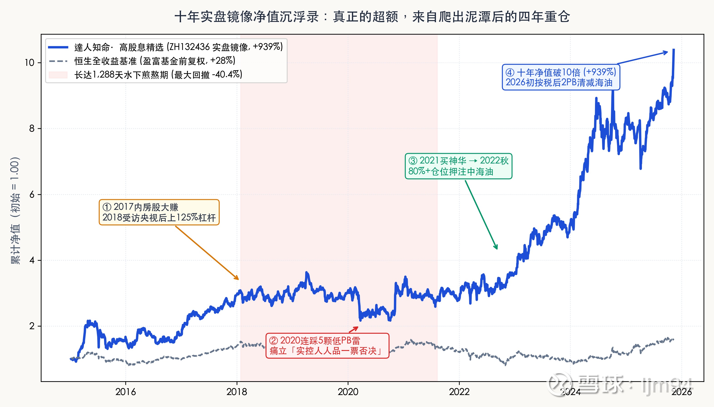
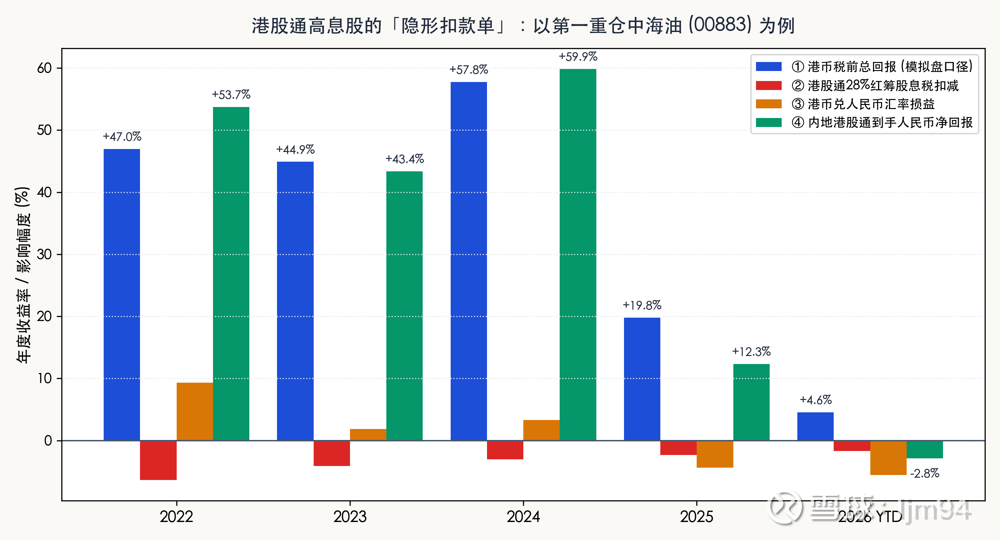
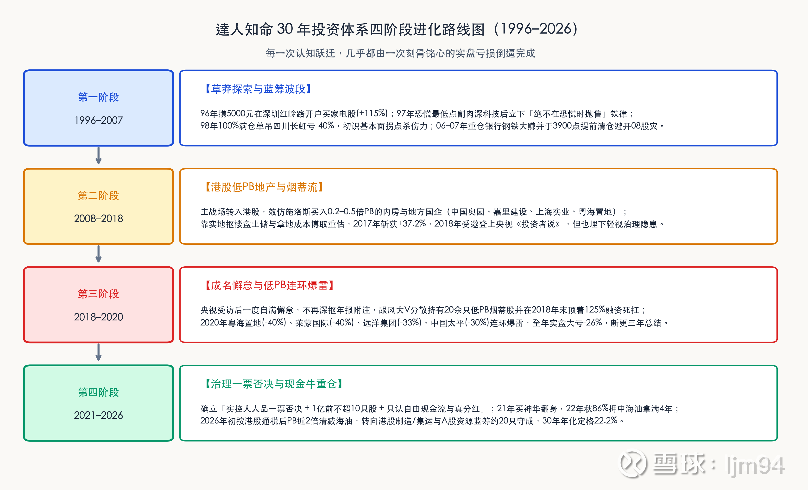
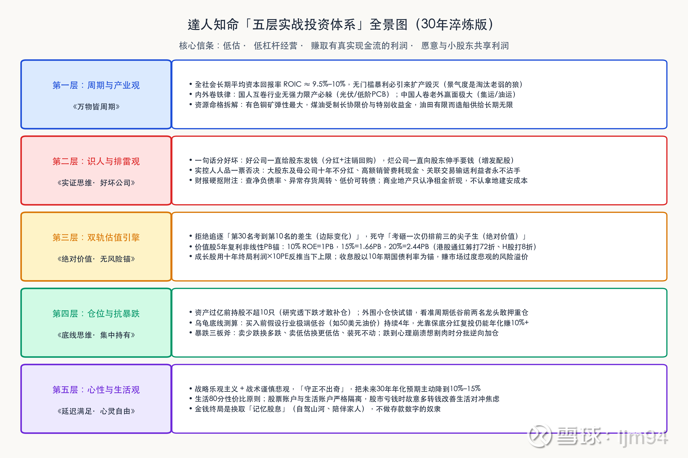
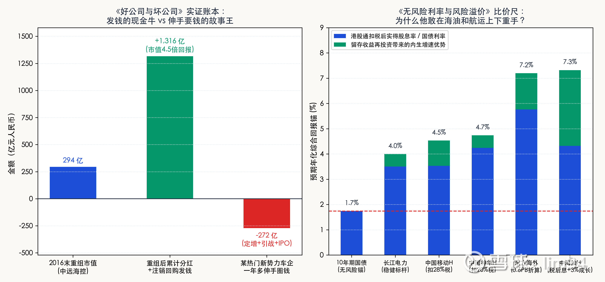
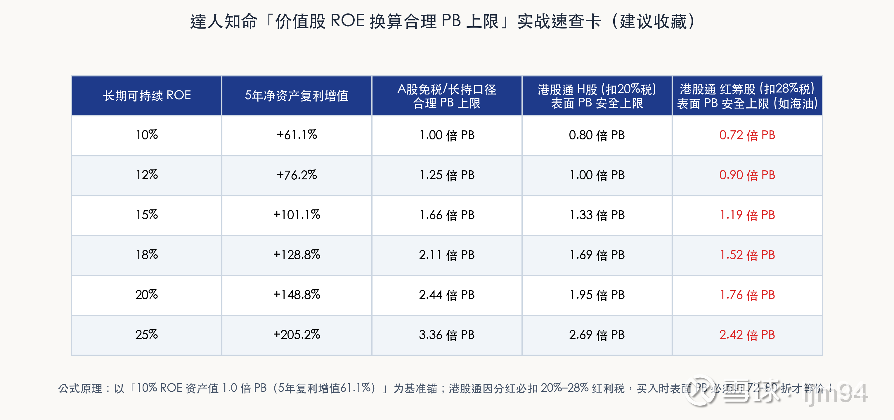
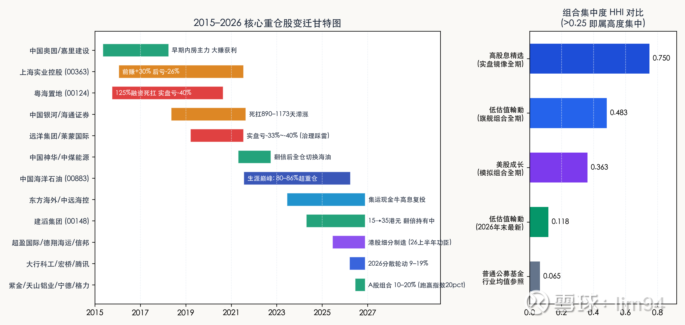
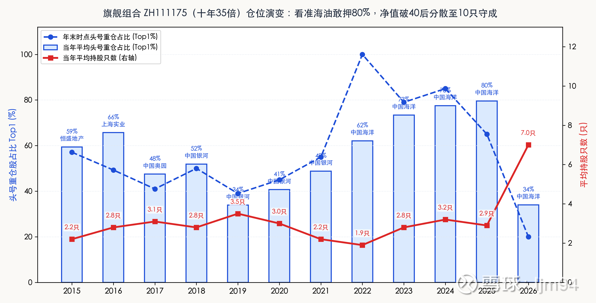
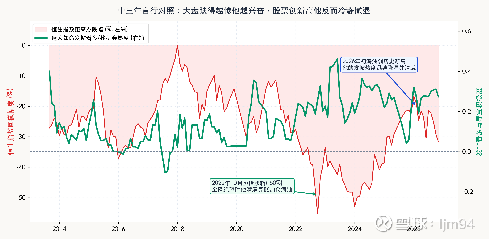
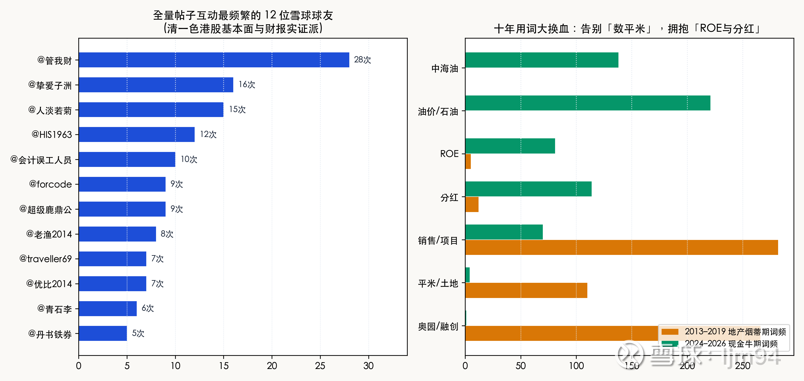

# 拆透老股民「達人知命」的投资体系与真账本（文章）

> 来源：雪球「ljm94」\
> 原文链接：https://xueqiu.com/5074021865/418583195?scene=1036&share_uid=1238039784\
> 作者：ljm94（雪球 UID 5074021865；share_uid 1238039784 为分享者）\
> 发布时间：2026-11-25 16:36 发布（页面时间戳 1795595806000），修改于 2026-11-26 07:56，来自雪球 · 日本\
> 资料类型：第三方投资体系拆解长文（非当事人自述；作者自述统计 986 条帖、84 篇长文、8 个组合 909 笔调仓，统计基准日 2026-11-25）\
> 入库时间：2026-11-27

---

## 摘要

> 核心话题：投资体系拆解 · 三十年实盘账本 · 周期与产业 · 排雷实证 · 双轨估值 · 仓位纪律 · 心性

**一句话核心**：一位雪球作者用 986 条帖、84 篇长文、909 笔调仓记录拆解老股民「達人知命」的三十年——**年化 22.2%（人民币加权）不是靠天赋，而是靠挨打后一条条套上的"紧箍咒"**：万物皆周期 + 实证排雷 + 绝对价值估值 + 极端集中 + 心性自洽的五层体系；同时明确指出**83%–86% 单票极限仓位普通人不可照搬**。

**关键数据**：

- 投资年限与收益：1996–2025 年人民币加权年化 **22.2%**，5000 元本金滚大 **三百多倍**，实盘数千万元级别；2020 年前后全职投资（来源：原文）
- 两个雪球组合：旗舰「低估值輪動(ZH111175)」净值最高约 **40 倍**（最新约 35.3 倍）；镜像「高股息精选(ZH132436)」十年累计 **+939.04%**、年化 **+24.11%**，最大回撤 **−40.44%**、三年半不创新高，同期盈富基金年化仅 **+2.88%**（来源：原文）
- 税与汇差：雪球组合按港币税前毛股息复投；港股通红筹扣 **28%** 红利税、H 股扣 **20%**。2025 中海油港币税前总回报 +19.78%，扣税 −2.34%、汇差 −4.35%，内地人民币实得 **+12.33%**；2026 前 11 月港币毛回报 +4.6%，扣税汇后 **−2.8%**（来源：原文）
- 挨打账本：1998 单吊四川长虹实盘 **−40%**；2018 央视后心态膨胀、顶 **125%** 融资仓位，2019 仅赚 6%、2020 实盘 **−26%**，"亏损五虎上将"粤海置地 −40%、莱蒙国际 −40%、远洋集团 −33%、中国太平 −30%、上海实业控股 −12%，年终总结断更三年（来源：原文）
- 产业底牌：麦肯锡 1963–2004 美股 7000 家非金融公司 ROIC 中位数 ≈**10%**，罗素 3000 1990–2022 加权 ≈**9.5%**，巴菲特观察战后 500 强中枢 **10%–12%**；紫金巨龙铜矿净利率 65%–70%，神东煤受长协限价净利率压到 **30%**，海油油价超 85 美元石油特别收益金抽 **40%**（来源：原文）
- 实证对比：中远海控 2016 年底 A+H 总市值 **294 亿元**，2021–2025 五年派现 1218 亿 + 回购注销 98 亿 = **1316 亿元**（市值 4.5 倍）；某新能源车企一年多 A 股定增 81.6 亿 + 子公司引战 61.2 亿 + H 股 IPO 129 亿 = 向市场要 **272 亿元**（来源：原文）
- 五年复利 PB 尺：10% ROE 五年增值 61.05%；15% → 101.1% 对应 **1.66 倍 PB**，20% → 148.8% 对应 **2.44 倍**，25% → 205.2% 对应 **3.36 倍**；港股通红筹再 ×0.72 安全锁（来源：原文）
- 仓位证据：8 组合 909 笔调仓，全股票持有中位数 35–37 天，中海油 **1916 天（>5.2 年）**；高股息精选全期平均 HHI **0.750**、低估值輪動 **0.483**（普通公募约 0.065，>0.25 即高度集中）；2026 年 11 月平均持股扩到 7 只、头号重仓压回 20% 以内、HHI 降至 **0.118**（来源：原文）
- 底线思维剧本：布伦特 50 美元 ×4 年、海油 18.4 → 12 港元，10000 股股息复投成 13275 股，第 5 年 80 美元/6 倍 PE（24.34 港元）总市值 32.3 万港元 vs 本金 18.44 万，五年 +75%、**年化 11.8%**（来源：原文）
- 能力与盲区：233 笔已完结交割中，亏损平仓平均持有 167 天 vs 盈利平仓 100 天，"卖飞票"（清仓后一年涨超 20%）占四成以上；高股息精选 2018.1–2021.8 经历 **1288 天（三年半）不创新高**；2026 美股组合重仓中概年内 **−28.2%**，跑输标普 500 三十多个百分点（来源：原文）

**核心矛盾**：

1. 模拟组合年化 24.11% vs 实盘人民币 22.2%——**港币税前毛股息自动复投**与港股通 20%/28% 红利税 + 汇差之间的口径鸿沟
2. "低估值分散"的施洛斯式 20 多只持股 → 踩雷概率大、收益平庸 vs "研究透了就集中、下跌敢补仓"的 ≤10 只——作者自述实盘 26 年年化 18%、三个港股组合 7 年年化 **26.2%**
3. 市场追捧"差生边际进步"（ROE 5%→10% 即给高 PB）、踩踏"尖子生轻微退步" vs 他死守**尖子生绝对价值**，代价是三年半不赚钱与 −40% 回撤
4. 严苛排雷（实控人人品一票否决、精读附注、只认真实现金流） vs **83%–86% 单票极限仓位**：研究再透也暴露在不可分散的极端黑天鹅下
5. 二十年制造业成本思维（算矿山/油田/集装箱如鱼得水）vs 轻资产平台、消费品牌溢价、长久期成长股的能力圈盲区（14 元卖美的、163 美元卖苹果、111 美元卖台积电）

**跟踪要点**：

1. 2026 年初海油估值到位（涨到 1.43 倍 PB，红筹税后折算 1.99 倍，越过 1.19 倍安全线）后清减，分散到港股制造、集运、A 股资源股守成，第二个 30 年收益目标主动降到 **10%–15%**
2. 低位区域介入（"不是一个价位，而是一片区域"）、持有 2–4 年、只买数一数二的公司——**周期低点 + 龙头**是合取条件
3. 排雷四铁闸：实控人人品一票否决（查母公司十年老底）· 只认真实现金流（不认投入成本/重置 PB）· 避开高管代理黑箱与乱花钱国企 · 精读年报附注不听高管画饼
4. 仓位纪律："绝对低估绝对重仓，相对低估相对重仓，正常价值维持 20% 左右"；外围小仓试错、看准重锤出击；大跌三招（换跌得更多的 / 换估值更低的 / 装死不动）
5. 心性与生活底座：80 分消费原则 · 生活账户反向转账（亏钱时多花钱弥补）· "记忆股息"（体验 > 物质）

## 正文

在雪球泡了这么多年，见过太多顺风时封神、逆风时删帖销号的流星，真正让我打心底里崇拜、每逢发长文必逐字细读的前辈，掰着手指头也数不出几个。[@達人知命](https://xueqiu.com/n/%E9%81%94%E4%BA%BA%E7%9F%A5%E5%91%BD) 绝对是我最服气的一位。

说崇拜一点都不夸张。一个普通财会人能在股市里摸爬滚打三十年，把五千块本金一步步滚成几千万身家，本身就已经是万里挑一的硬本事；更让人敬重的是他身上那股少见的坦荡与干净——他从不装神弄鬼预测大盘点位，不造玄学黑话，不开付费圈子收割粉丝，赚了钱把算账底稿摊在桌面上任人核对，栽了大跟头也能把自己的贪婪与膨胀一刀刀剖开给所有人看。为了真正学透这位我仰慕已久的前辈到底是怎么炼出这套真功夫的，而不是只盯着代码抄作业，这几天我干了一件笨事：把 達人知命 十三年来留在雪球上的 **986条帖子、84篇长文**，连同 **8个组合的909笔调仓记录** 全部拉下来，从头到尾啃了一遍。

故事的起点，要倒回三十年前那个冷清的冬天。

1996年春节前，深圳红岭路的深圳证券登记公司里冷冷清清，几百平米的大厅只有一个人来办业务。

柜台后的工作人员很久没见过新股民了，看见这名刚来深圳闯荡的财会专业毕业生，高兴地跟他说：“现在股市很低，正好是买入的好时机，你办了不会错的。”那天上证指数只有500多点，年轻人掏出攒下的5000块钱，买进了人生头两只股票——5到6倍市盈率的[深康佳](https://xueqiu.com/S/SZ000016?from=status_stock_match)和皖美菱。

三十年后的今天，当年那个办股东卡的年轻人，成了雪球上拥有11.5万关注的 達人知命。

他刚满三十年的投资账本，定格在一组很有分量的数字上：1996至2025年，人民币加权年化复合收益率 **22.2%**，最早投入的那5000块钱滚大了三百多倍；加上他在深圳电子代工制造业干满二十年攒下的薪水投入，实盘体量早已跨入数千万元级别，2020年前后辞去工作全职投资。他在雪球公开打理十余年的旗舰组合 [低估值輪動(ZH111175)](https://xueqiu.com/P/ZH111175 "https://xueqiu.com/P/ZH111175") 净值最高摸到40倍（最新约35.3倍），与他实盘几乎同步的镜像组合 [高股息精选(ZH132436)](https://xueqiu.com/P/ZH132436 "https://xueqiu.com/P/ZH132436") 十年累计净值也超过了10倍（+939.04%）。

如果只看结果，很容易把它当成一篇顺风顺水的民间股神爽文。

可当你把他过去十三年的近千条发言和交割记录全部摊开对照，看到的却是一个真实得甚至有些狼狈的血肉之躯：他干过1998年单吊一只票腰斩四成的蠢事；也在2018年风光登上央视《投资者说》之后心态膨胀，顶着125%的融资杠杆冲进港股低PB地产陷阱，连踩五颗大雷，亏到连续三年不好意思在雪球写年终总结。

他不是靠天赋异禀封神的。恰恰相反，他所有的赚钱本事，全是在一次次挨揍之后，用财会人算死账的笨功夫，一条条给自己套上“紧箍咒”磨出来的。

先看两张核验他业绩成色的硬账单。

*图1：最贴近其实盘的镜像组合 ZH132436 日度净值对比恒生全收益基准（2015–2025）*

> 原图：https://xqimg.imedao.com/1a2117ed20d9cd043fe0b85e.png

他在《组合十年回顾》里坦诚交过底：35倍的 [低估值輪動](https://xueqiu.com/P/ZH111175 "https://xueqiu.com/P/ZH111175") 早年满仓轮动港股地产有运气成分，美股组合自己压根没真买，真正跟实盘操作重合的，是2015年初建仓、2025年11月关停的 [高股息精选](https://xueqiu.com/P/ZH132436 "https://xueqiu.com/P/ZH132436")——十年年化 **+24.11%，中间扛过 -40.44% 的最大回撤和整整三年半的不赚钱煎熬期，而同期把股息全算进去的[盈富基金](https://xueqiu.com/S/02800?from=status_stock_match)年化只有 +2.88%。**

为什么模拟组合年化 24.1%，他自述的人民币实盘却是 22.2%？因为雪球组合默认按港币税前毛股息自动复投，而内地投资者走[港股通](https://xueqiu.com/S/SH501309?from=status_stock_match)买 [中国海洋石油](https://xueqiu.com/S/00883?from=status_stock_match) 这种红筹股，每次分红到账要先扣 **28% 的红利税**（H股扣20%），年底还要承受港币兑人民币的汇率波动。

*图2：雪球组合按港币毛股息记账，内地[港股通](https://xueqiu.com/S/SH501309?from=status_stock_match)持有红筹股[中海油](https://xueqiu.com/S/00883?from=status_stock_match)需扣 28% 红利税并承担汇差*

> 原图：https://xqimg.imedao.com/1a2118123839e9bd3fe29ed9.png

拿2025年的除权数据一笔笔核对：[中海油](https://xueqiu.com/S/00883?from=status_stock_match)港币税前总回报明明有 +19.78%，但分红被扣走28%红利税直接拖累总收益 -2.34%，再赶上港币兑人民币贬值 -4.35%，内地账户实得人民币回报只剩 **+12.33%**。这跟他在2025年报里写的“税和汇率吃掉4个多点，全年实盘收益 +15.3%”分毫不差。到了2026年前11个月，海油港币毛回报还是正的 +4.6%，扣完税汇直接变成亏 -2.8%。

账本是干净的，伤疤也是真的。搞清了他这三十年是怎么一步步走过来的，才能真正读懂他那套压箱底的投资体系。

────────

#### 一、三十年四次蜕变：每长一次记性，都是真金白银挨打换来的

“我投资的前15年里，感觉大家都是看K线、看技术指标、听消息的居多，价值投资没有形成气候。后15年里，分析产业，分析公司，价投逐渐成为主流。”把这三十年拉通来看，他的认知经历了四次脱胎换骨的转折。

*图3：1996–2026 三十年投资体系四阶段进化路线图与关键转折诱因*

> 原图：https://xqimg.imedao.com/1a211821a4f9d8673fed2385.png

**头十二年（1996–2007），他在暴涨暴跌里刻下了两条保命本能。**

1996年底，管理层连发金牌令遏制投机，《人民日报》刊发特约评论员文章，大盘连吃三个跌停。他连续两晚翻来覆去睡不着觉，直到第三天手里的绩优股[粤电力](https://xueqiu.com/S/SZ000539?from=status_stock_match)拒绝下跌才终于睡踏实。可仅仅两个月后的1997年2月20日，邓公逝世消息传出，大盘开盘暴跌，他在极度恐慌中以全天最低价16.76元把 [深科技](https://xueqiu.com/S/SZ000021?from=status_stock_match) 割光，随后眼睁睁看着它一路涨到70元。这记耳光让他立下终生铁律：**绝不在市场恐慌时抛售股票。**

1998年，前两年的顺风顺水让他把100%身家单吊在4倍市盈率起家的 [四川长虹](https://xueqiu.com/S/SH600839?from=status_stock_match) 上，结果长虹搞“红太阳一号工程”盲目囤积彩管，利润下滑两成，股价腰斩，他当年实盘巨亏 **-40%**。吃过这次大亏后，他对过热行情格外警觉，2006–2007年靠银行和钢铁大赚后，在上证3900点提前清仓离场，躲过了2008年 -65% 的大崩盘。

**第二个十年（2008–2018），他在港股废墟里学会了算账，也染上了“捡烟蒂”的瘾。**

2008年底次贷危机席卷[珠三角](https://xueqiu.com/S/SZ399356?from=status_stock_match)，2009年春节过去一个月了，深圳街头依然空空荡荡，航运BDI指数从12000点摔到800点，“货主甚至不让船靠岸，因为船租比岸上的仓库租金还便宜”。他在 [东方海外国际](https://xueqiu.com/S/00316?from=status_stock_match) 上从42港元一路补仓到22元、12元，眼看着股价杀破10港元；又在从30块跌到3块多的 [合生创展集团](https://xueqiu.com/S/00754?from=status_stock_match) 上抄底，心想跌了90%总该见底了，结果最低跌到1.46港元，账面再浮亏60%

熬过那场危机后，他迷上了沃尔特·施洛斯的低估值分散打法，长年扎在0.2–0.5倍PB的港股内房与地方国企里抠楼盘土储。2016年赚 +19.3%，2017年在 [中国奥园](https://xueqiu.com/S/03883?from=status_stock_match) 和 [嘉里建设](https://xueqiu.com/S/00683?from=status_stock_match) 上大赚 +37.2%，2018年受邀登上了央视《投资者说》。

**2018到2020这三年，是他三十年里最疼的滑铁卢。**

他在2022年总结里毫不留情地剖析自己：“直到19年还可以说自己24年来年化超过20%。运气不错，慢慢就以为是自己的实力，尤其是18年央视采访自己以后，觉得自己确实厉害了，以前仔细研读财报的习惯慢慢丢掉了，雪球上看看大V的推荐，觉得靠谱就直接买，甚至买成重仓，都还没仔细看过年报。”

那两年他从“深研集中”滑向了“分散不深研”，手里攒了20多只所谓的低PB便宜货，2018年底甚至顶着 **125% 的融资仓位 过冬。结果2019年只赚6%，2020年实盘大亏** -26%，手里重仓的“亏损五虎上将”全线爆雷：粤海置地 亏40%、莱蒙国际 亏40%、[远洋集团](https://xueqiu.com/S/03377?from=status_stock_match) 亏33%、中国太平 亏30%、[上海实业控股](https://xueqiu.com/S/00363?from=status_stock_match) 亏12%。那三年他羞于动笔，年终总结断更了整整三年。

**2021年至今，砍掉妄念后的“现金牛重仓时代”。**

摔痛之后，他在2021年立下“实控人人品一票否决”和“1亿前持股不超10只”的死规矩，把没有真实现金流派息的烟蒂股全部清扫出门。先买 [中国神华](https://xueqiu.com/S/SH601088?from=status_stock_match) 和 [中煤能源](https://xueqiu.com/S/SH601898?from=status_stock_match) 翻身，再于2022年秋把八成以上身家压进[中海油](https://xueqiu.com/S/00883?from=status_stock_match)拿满四年主升浪；等到2026年初海油估值到位、沪指回到4000点与恒指26000点附近便宜货变少时，他又果断清减海油，分散到港股制造、集运和[A股资源](https://xueqiu.com/S/SH000805?from=status_stock_match)股里守成，把未来第二个30年的收益目标主动降到了 10%–15%

────────

#### 二、核心拆解：達人知命 的「五层实战投资体系」

很多球友看 達人知命，只看到他重仓[中海油](https://xueqiu.com/S/00883?from=status_stock_match)赚了大钱，以为他是运气好赌对了油价。但把他的84篇长文顺着逻辑串起来就会发现，他脑子里有一套极其严密、环环相扣的**五层实战投资体系**。

*图4：从底层产业规律、排雷铁律、双轨估值到仓位危机管理与心性底座的五层架构*

> 原图：https://xqimg.imedao.com/1a2118ad5449dc2c3fe6a0d3.png

#### 第一层：周期与产业底牌——万物皆周期，跟谁卷决定生死

在阅读量很高的专栏《万物皆周期》里，達人知命 抛出了他看所有生意的起点：**全社会的长期平均资本回报率（ROIC）到底是多少？**

他摆出了三组跨越几十年的硬数据：麦肯锡统计1963–2004年美股7000家非金融公司，中位数 ROIC ≈ 10%；罗素3000指数1990–2022年剔除金融地产后，加权平均 ROIC ≈ 9.5%；巴菲特早年观察战后财富500强工业企业，长期ROIC中枢也在 10%–12%。

基于这个铁律，他得出了一个冷酷的推论：**任何一个没有绝对门槛（行政牌照、核心技术或稀缺资源限制）的行业，只要当下赚取超额暴利，资本就一定会蜂拥而入，直到产能过剩、全行业亏损，再经历一轮痛苦的倒闭去产能，周而复始。** 他打了个极形象的比方：“任何让全行业都高盈利的景气不会一直维持。就像动物世界里，狼的存在淘汰掉种群里的老弱个体，行业景气度就是这只狼。”

既然万物皆周期，中国制造业和周期股该怎么选赛道？他在制造工厂摸爬滚打了二十年，总结出一条极毒辣的**“内外卷法则”**

**中国人跟中国人自己卷的行业，如果没有像电解铝4500万吨产能天花板那样的强力行政管束，再景气也必须躲着走**——哪怕强如光伏龙头[隆基绿能](https://xueqiu.com/S/SH601012?from=status_stock_match)，或者扩产后的低阶PCB厂商，在同胞的极致内卷下也只能在红海里挣扎；**反过来，如果是中国人和外国人卷的行业，赢的概率就太高了**——老外讲工会组织、讲休假权益、技能和拼劲都不如东亚企业，典型像集装箱航运和油运，全行业平均回报10%的时候中国龙头能赚15%，全行业亏得底掉的时候，东亚船东照样能赚5%。

更见功力的，是他对同属上游资源股的**“有色 vs 煤油 vs 航运”命格拆解**。

2026年初他在《得天独厚的有色，苦命的煤油》里算过一笔账，解释为什么铜金狂飙时，同样拥有顶级矿产的神华和海油却赚不到同等暴利：拿 [紫金矿业](https://xueqiu.com/S/SH601899?from=status_stock_match) 的巨龙铜矿来看，完全成本3.3万元/吨，铜价10万以上扣掉增值税净卖9万，净利润率高达 65%–70%；而[中国神华](https://xueqiu.com/S/SH601088?from=status_stock_match)最肥的神东矿区，开采成本仅130元/吨、完全成本330元，按2022年市场煤价1250元扣税费本该净卖900元、同样拿走60%的净利率，可因为电煤关乎国计民生，神东煤只能按700元的长协限价卖，净利率硬生生封在了30%。[中海油](https://xueqiu.com/S/00883?from=status_stock_match)也是同理，2022年实现油价96.6美元、桶油完全成本仅37美元左右，但国家设有阶梯式的“石油特别收益金”——油价超过65美元就开始征收20%，超过85美元直接抽走 **40%。**

即便如此，当有球友在评论区追问他：“东方海外长期平均ROE比[中海油](https://xueqiu.com/S/00883?from=status_stock_match)还高、PB更低、[港股通](https://xueqiu.com/S/SH501309?from=status_stock_match)股息税还少扣8个点，你为什么反而拿八成仓位买中海油，只拿零头买东方海外？”

他的回答堪称产业比较的范本：一是[中海油](https://xueqiu.com/S/00883?from=status_stock_match)早年高价收购优尼科的历史包袱已经计提干净，加拿大油砂的主要成本从80多美元一路降到了26.5美元，管理层一以贯之地优秀；而东方海外脱离老船王董氏家族掌舵后，签下112亿租船大单，派息可预见性不如从前。二是最本质的物理约束——**地球上的优质石油储量是有限的，而只要有钱去船厂下订单，造船的供给拉长时间看几乎是无限的**

把这几笔账读懂了，你就明白他重仓哪只票、轻仓哪只票，背后全是实打实的产业斤两，没有半点拍脑袋的成分。

────────

#### 第二层：识人与排雷实证观——发钱的是好公司，要钱的是烂公司

2020年那五颗大雷炸完之后，達人知命 把自己的选股标准收窄到了近乎严苛的“实证主义”：**不听任何宏大叙事，只查过去十年真金白银干了什么。**

他在《好公司与坏公司》里摆过一组让人看一眼就忘不掉的数字对比：

*图5：左图为[中远海控](https://xueqiu.com/S/01919?from=status_stock_match)与某新势力车企的股东现金流对比；右图为1.74%国债锚下的五大收息资产比价*

> 原图：https://xqimg.imedao.com/1a2118c2e339d8ff3fe5d896.png

2016年底 [中远海控](https://xueqiu.com/S/01919?from=status_stock_match) 完成重组时，A股加H股合计总市值只有 **294亿元人民币。熬过五年航运低谷后，从2021到2025年，海控五年累计向股东派发现金分红** 1218亿元，外加回购注销 **98亿元，真金白银给股东发了** 1316亿元——相当于把当年整个公司市值的4.5倍塞进了股东口袋；它2017年花每股78.67港元买下的东方海外，收购后光每股分红就拿回了206港元。

而在同一天官宣调整合作模式的某热门[新能源车](https://xueqiu.com/S/SZ399417?from=status_stock_match)企，一年多时间里先在A股定增要走81.6亿，子公司引战融资61.2亿，转身又去H股IPO募资129亿，短短一年多向市场伸手要了 **272亿元人民币**。“我估计大概率直到它结束运营也分不了这么多红。**好公司就是一”直给股东发钱的公司，烂公司就是一直找股东要钱的公司。** 可惜有人就是相信故事，不相信实实在在的股东回报。

为了防止再掉进港股常见的“低估值陷阱”，他从当年五虎上将的血泪教训里提炼出了四道排雷铁闸：

**第一道铁闸是“实控人人品一票否决，查老底要查到母公司十年前”。**

当年他在莱蒙国际上亏掉40%，最困惑的是这家公司上市六七年一直正常派息、开业绩会，一点不像老千股，怎么卖掉地产项目回笼50多亿现金后突然变脸不分红，每年用4个多亿的行政销售费用把账上现金慢慢吃光？想通之后他背脊发凉：“正常经营时老板要考虑形象，还要融资、要小股东支持；一旦功成身退退出主业，还能想到小股东的已经是凤毛麟角。”从此他看任何新股或分拆股先查母公司老底——2022年他研究[兆科眼科](https://xueqiu.com/S/06622?from=status_stock_match)，账面现金极多、眼科赛道也好、股价才2块多远低于净资产，但他顺手一查母公司[李氏大药厂](https://xueqiu.com/S/00950?from=status_stock_match)过去十几年几乎没让小股东赚过钱，当场一票否决，完美避开了此后的漫长阴跌。

**第二道铁闸是“资产估值只认[自由现金流](https://xueqiu.com/S/SZ980092?from=status_stock_match)，绝不拿投入成本自欺欺人”。**

他在粤海置地上亏掉40%，就是因为买入时算着“相当于12000元一平米买深圳罗湖的房产，赚大了”，多年后才痛悟商业办公楼不卖只租，哪怕钢筋水泥花了一千亿，只要租金扣掉税费和物业费剩不下几个钱，这堆重资产对小股东就是废铁。同理，球友拿大桥和老厂房的“重置成本低PB”来问他时，他一句话顶回去：“大桥建成这么久还亏损，明明就是烂资产，算重置PB有用吗？三线建设废弃的老厂房按一平米五千算重置成本，你买吗？”

**第三道铁闸是“避开高管代理黑箱与乱花钱的米虫国企”。**

当年他听大V吹捧内含价值和剩余边际重仓中国太平，亏了30%割肉换成神华，想通的死穴只有一个：“寿险负债端确实赚钱，但资产端呢？一个拿一两百万年薪的打工高管，去投一个几十亿上百亿的项目，且一两年内根本看不出好坏，你凭什么确保他没有私心？”而在[上海实业控股](https://xueqiu.com/S/00363?from=status_stock_match)上，收费公路和南洋烟草每年赚回大把硬现金，管理层却只拿零头分红，把大头拿去借债投烂项目、养冗员米虫。只要赚来的现金不肯大比例分掉，留在坏管理层手里早晚变成坏账。

**第四道铁闸是“精读年报附注，不听高管当面画饼”。**

他在《扫盲贴：净负债率》里早就拆穿过2015年 [融创中国](https://xueqiu.com/S/01918?from=status_stock_match) 的报表把戏——总销售549亿，并表收入只有230亿，把大量负债藏在非并表合营公司里，真实净负债率比账面80%至少高出一倍。他提醒球友，企业对自己的优势会敲锣打鼓，对致命硬伤只会在**财报附注里悄悄提一笔（比如天彩控股存货高达9个月销货成本、[优然牧业](https://xueqiu.com/S/09858?from=status_stock_match)在港股低价发可转债），所以附注必须逐字抠，同时严守盖伊·斯皮尔的规矩：“不要和上市公司管理人员谈话——去热门公司调研听几句星辰大海回来就买，亏损概率80%。”**

────────

#### 第三层：双轨估值计算器——不追“差生进步”，死守“尖子生绝对价值”

排完了雷，好公司到底多少钱能买、多少钱该卖？達人知命 的估值体系之所以好用，是因为他从不搞复杂的十页Excel折现模型，而是抓住了最本质的三个算账支点。

**支点一：用“班级排名”看穿市场对边际变化的狂热。**

在《边际变化与绝对价值》里，他把ROE比作学生的班级成绩：ROE 20%+ 是班里数一数二的尖子生，10%–20% 是前十名，5%–10% 是中等生。

他发现A股和港股绝大多数时候都在干一件荒唐事——**疯狂追捧“差生的边际进步”，无情踩踏“尖子生的轻微退步”**。一个原本排第30名的差生这学期考到了第10名（ROE从5%升到10%，利润暴增100%），市场立刻沸腾了，幻想他下学期就能考全班第一，给的市净率比常年第一名的尖子生还贵；反过来，常年考第一的学霸这学期发挥失常退到了第三名（比如[中海油](https://xueqiu.com/S/00883?from=status_stock_match)ROE从20%降到16%），市场就觉得天塌了，按1倍PB往下砸

“然而99%的可能性是，那位进步神速的同学只不过是从5%进步到了10%，他这辈子也摸不到18%的ROE门槛；而退步到第三名的尖子生，哪怕油价跌到60美元，ROE照样比那个大涨92%利润、估值2.2倍PB的互联网零售股（ROE 13.2%）更高。”机构因为考核期短，不得不去博弈差生的边际改善；散户手里最锋利的武器，恰恰是在尖子生考砸被嫌弃时，按绝对价值买进去收息。

**支点二：价值股的“五年复利非线性PB尺子”与[港股通](https://xueqiu.com/S/SH501309?from=status_stock_match)扣税折扣。**

很多初学价投的人按线性思维算账：既然 10% ROE 的平庸资产值 1.0倍PB，那 15% ROE 是不是值 1.5倍PB、20% ROE 值 2.0倍PB？

他在《价值股与成长股的估值计算》里指出了复利的非线性威力：为什么人看长期最多只算5年？因为商业世界能看清的极限也就5年。按5年净资产复利算，10% ROE 五年累计增值 61.05%；15% ROE 五年增值 101.1%；20% ROE 五年增值 148.8%；25% ROE 五年增值 205.2%。拿高ROE资产五年多赚出来的复利增量去除以基准的 61.05%：

- 15% ROE 合理上限 = 101.1 ÷ 61.05 = 1.66倍 PB

- 20% ROE 合理上限 = 148.8 ÷ 61.05 = 2.44倍 PB

- 25% ROE 合理上限 = 205.2 ÷ 61.05 = 3.36倍 PB

有人问他：你这套公式里怎么没提分红率？他一句话点透了高ROE与高分红的一体两面：**“成熟企业没办法长期维持10%以上的规模增长，如果不把赚来的钱大比例分红分掉，留存净资产越堆越厚，ROE就一定会持续往下掉。”** 换句话说，能长期稳住15%–20% ROE的成熟公司，天然必须是慷慨分红的公司。

但如果是隔着[港股通](https://xueqiu.com/S/SH501309?from=status_stock_match)买港股，他还加了一道极其严苛的安全锁。有球友问他：“算股息率要扣28%的税我理解，为什么你算合理PB也要把28%的税扣掉？”他只回了九个字：**“迟早要分的，回报一定会少28%。”**

*图6：不同长期可持续 ROE 在 A股、[港股通](https://xueqiu.com/S/SH501309?from=status_stock_match)H股（20%税）、港股通红筹股（28%税）下的表面 PB 安全上限*

> 原图：https://xqimg.imedao.com/1a2118d13559ea763fb30da7.png

对照这张速查卡，他在2026年2月清减[中海油](https://xueqiu.com/S/00883?from=status_stock_match)的操作就没有任何秘密可言了：海油往前看常态ROE在15%左右，免税口径合理上限是 1.66倍PB；按[港股通](https://xueqiu.com/S/SH501309?from=status_stock_match)红筹股打72折压低安全线，表面PB一旦越过 **1.19倍** 就不再便宜。当2026年初海油涨到 1.43倍PB（除以0.72折算税后高达 1.99倍PB）时，在他眼里安全边际已经彻底归零，走得干脆利落

**支点三：成长股用“十年终局思维”，收息股用“[十年国债](https://xueqiu.com/S/SH511260?from=status_stock_match)锚”。**

碰到高速增长的成长股没法套PB公式怎么办？他用**终局倒推法。2021年底 [比亚迪股份](https://xueqiu.com/S/SZ002594?from=status_stock_match) 销量暴增230%，市值冲上7850亿、市盈率200多倍，身边朋友都在聊PEG估值。他按计算器算了笔笨账：就算[比亚迪](https://xueqiu.com/S/SZ002594?from=status_stock_match)一切顺利，十年后长成今天[丰田汽车](https://xueqiu.com/S/TM?from=status_stock_match)的体量——年销破千万台、一年赚丰田级别的1650亿净利润，到那时候它已是成熟制造业巨头，按10倍PE算总市值也就** 16500亿。从7850亿到16500亿，十年满打满算才涨110%，况且它有多大概率能达成？中间会不会增发摊薄股本？算完这几笔折扣，200倍PE的诱惑瞬间清零，成功避开了此后数年估值的剧烈消化。

而买收息蓝筹时，他的锚则是**中国十年期国债收益率**（2024年底降到 1.74%，见图5右栏）。他把几大收息巨头放在同一张桌子上比价：[长江电力](https://xueqiu.com/S/SH600900?from=status_stock_match)最稳，给3.5%股息率；[中国移动](https://xueqiu.com/S/SH600941?from=status_stock_match)H股扣完28%税到手约3.5%；中国神华H股扣完20%税到手约4.2%。这三家因为把75%的利润都分掉了且缺乏高回报新项目，未来内生增长很慢。唯独中海油只分掉45%的利润（税后股息率仍超4.3%），却把剩下55%的留存资金投向高回报的海上油气田建设，油价不变每年也能比前三家多出 **3个百分点以上的产量内生增长**；而0.6倍PB的东方海外按稳态12% ROE、50%派息折算，隐含税后回报也在7%以上。谁被市场先生收了过高的风险溢价，一目了然。

────────

#### 第四层：仓位收放与危机活命术——909笔调仓底牌与“乌龟底线法”

2022年1月，達人知命 写过一篇对自己触动极深的复盘《组合与实盘差距的思考》：他统计发现自己26年精心操作的实盘年化是 18%，可自己在雪球上偶尔打理、每次只拿两三只最放心股票的三个港股组合，七年平均年化居然高达 **26.2%**。

“究竟有什么不同？我的实盘强调低估分散，最多时拿二十几只。但人的精力有限，研究不过来，很多只知道个大概，踩雷概率大增，涨跌一平均收益就很平庸。去年以来逐渐从分散走到集中，**关键是研究透了，下跌敢补仓，比以前心慌慌强了不知多少。个人感觉，在资产达到一个小目标之前，不宜超过10只股票。** 不是说施洛斯的风格不好，只是多年体验下来，知道这种风格不适合我。”

我们把他8个组合里全部 **909笔调仓记录** 拆开还原，画出了过去十一年核心重仓股的甘特图，并算出了组合集中度（赫芬达尔指数 HHI，普通公募基金分散买几十只票约为 0.065，超过 0.25 即属高度集中）：

*图7：左图为2015–2026核心重仓变迁甘特图；右图为各组合平均集中度 HHI 对比*

> 原图：https://xqimg.imedao.com/1a21193d20d9d9503fed0751.png

在最贴近实盘的 [高股息精选](https://xueqiu.com/P/ZH132436 "https://xueqiu.com/P/ZH132436") 里，全期平均 HHI 高达 **0.750**（常年把七八成仓位压在一只头号主力上），旗舰组合 [低估值輪動](https://xueqiu.com/P/ZH111175 "https://xueqiu.com/P/ZH111175") 全期平均 HHI 也达到 **0.483**。全量交割记录里，他所有股票的中位数持有时间只有35到37天，唯独看透了的中海油，他在组合里死死抱住了 **1916天（超过5.2年）**——外围拿小仓位快速试错，看错一个月就走；一旦摸准百年一遇的肥肉，清掉杂毛重锤出击。

再看旗舰组合 [低估值輪動](https://xueqiu.com/P/ZH111175 "https://xueqiu.com/P/ZH111175") 过去十二年**头号重仓占比（Top1%）与平均持股只数**的反向剪刀差，更是把他的仓位纪律演活了：

*图8：旗舰组合 ZH111175（2015–2026）历年头号重仓占比与平均持股只数的收放节奏*

> 原图：https://xqimg.imedao.com/1a211948ef89eadf3fd05eb1.png

**“绝对低估时绝对重仓，相对低估时相对重仓，反映正常价值时维持20%左右的仓位。” 2022到2025年海油绝对低估时，他把组合持股压到2到3只，单票仓位顶在 62%–80%（实盘高达 83%–86%），四年让净值从7倍飞跃到40倍；等到2026年市场整体回暖、明显低估的大票绝迹时，他又主动把平均持股扩到7只（11月末达10只：大行科工 19.3%、建滔集团 17.1%、腾讯控股 13.9%、信邦控股 9.8%、中国宏桥 9.5%等），头号重仓压回20%以内，最新集中度 HHI 降到了温和的** 0.118。

重仓拿得住的前提，是在暴跌来临前把最坏的底牌算透。把过去十三年恒生指数的回撤幅度与他每月发帖寻找机会的热度叠在一起看，能清晰看到他骨子里的逆向本能：

*图9：十三年恒生指数回撤幅度（红区）与他发帖看多算账热度（绿线）呈鲜明反向运动*

> 原图：https://xqimg.imedao.com/1a211953f009ce3d3fed702a.png

每当恒指跌得血肉模糊（比如2022年10月恒指腰斩50%，或者2025年4月关税大棒砸崩油价），全网一片绝望时，他的发帖积极度总是逆势冲上顶峰；反倒是2026年初海油冲破27港元创历史新高、论坛锣鼓喧天时，他的发帖热度迅速降温，悄然完成了清仓式减持。

2025年4月6日油价暴跌那晚，手里捏着80%多仓位中海油的他自嘲“像一只被套牢的大闸蟹”，却连夜写出了那篇著名的《中海油的底线思维》：假设最狠的剧本出现——布伦特油价被干到 **50美元/桶** 并连续趴在谷底 **4年**，直到把美国高成本页岩油彻底熬死才反弹回80美元；假设海油股价从18.4港元暴跌到 **12港元**（对应50美元油价下7.8倍低谷PE），自己一股不卖，只用“乌龟流”把每年50%分红拿去低位买股复投。

他拿10000股本金一笔笔算下来：4年股息复投后手里变成13275股，第5年油价回到80美元哪怕市场只给6倍PE（对应24.34港元），总市值变成32.3万港元，对比暴跌前18.44万本金，五年总收益依然有75%，**年化复合回报 11.8%**。“一个企业主不会因为降价周期，就卖掉自己的油田，毕竟降价周期也卖不出好价钱。”

对于普通人怎么熬过暴跌，他留过三条极简的实操规矩：遇到大跌，要么把跌得少的卖掉换跌得更多的优质股，要么把估值低的换估值更低的，要么直接装死不动；如果手里的蓝筹股已经被大家反复研究透、确认公司没硬伤，“**等有一轮跌势跌得你实在受不了、想着无论如何也要卖出的时候，就开始加仓。**”

────────

#### 第五层：心性与生活底座——80分消费、生活费反向转账与“记忆股息”

很多全职投资人管得住估值，却管不住心态和生活。達人知命 能稳稳拿住股票三十年，很大程度得益于他极其自洽的生活哲学。

他常引用雪球前辈散户乙的一句话：**“学巴菲特要么学全套，要么一点也学不到。”** 意思是精打细算的性价比思维，在真正的价值投资者身上早已刻进日常生活本能里。朋友去香港维港看烟花吐槽酒店8000块一晚太贵，他这才意识到自己这辈子住过最贵的酒店是新西兰1800元一晚的四星级，平时在国内自驾路过住一晚全季就挺满意，淡季度假选五星级也不到一千块。

他管这叫 **“80分消费原则”**：60分的东西品质太差，比80分便宜不了几个钱；90分、95分的奢侈品品质只比80分高两成，价格却要贵出好几倍，纯属交智商税。

节俭归节俭，他在对冲股市坏情绪上却有一招极聪明的**“生活账户反向转账法”**。2026年11月下旬港股回调、手里20只票有17只年内浮亏时，他笑呵呵地发帖说：股票亏钱的时候，反而要从股票账户多转一点钱到生活账户，花钱要比平时更大方一点，“因为要用生活品质来弥补投资上的缺憾”。甚至开玩笑说拔网线已经不管用了，“干脆把手机卖掉，既能赚点钱补贴生活费，又可以不看行情不受刺激”。

到了五十多岁的年纪，读完比尔·珀金斯的《Die With Zero》，他对钱与人生的关系看得很通透：如果一个人在职场拥有一份能“跳着踢踏舞去上班”的事业，不管多有钱都别轻易辞职全职炒股；反过来，如果觉得上级和同事面目可憎、纯为碎银几两忍气吞声，达到初级财务自由就该早点赎回自己的时间自由。至于钱的终局去向，物质会折旧遗忘，唯有自驾山河、陪伴家人换来的体验能产生一辈子的**“记忆股息”**。

────────

#### 三、他在雪球里服谁、常跟谁切磋？

在雪球待久了就会发现，看清一位大V成色最快的方法，是看他平时跟谁来往、私底下关注谁的组合。

達人知命 在《投资中的实证思维》里把鉴别“真高手”和“码字写手”的标准说得很绝情：有公开私募产品净值最好（比如他点名认可五年以上年化明明白白20%+的雪球私募老将），没有产品就看雪球组合——**“多年复合收益10%以下的可以直接忽略；有些人建几十个组合只拿最好的那个出来说事，把他的全部组合收益平均一下就原形毕露了。”** 早在2022年他就痛批过某位坐拥60万粉丝、唯一组合跑了8年还回不到1块钱净值的流量大V。

我们把他986条帖子里的全部互动对象、他主页关注的组合和公开推荐名单梳理出来，他的雪球朋友圈干净得像筛子筛过一样：

*图10：左图为全量986帖互动频次最高的12位雪球球友；右图为其十年高频词换血轨迹*

> 原图：https://xqimg.imedao.com/1a21196dca49d9733fde3129.png

跟他互动最频繁的，清一色是雪球上摸爬滚打十余年的港股实证派老友。排在榜首的是港股老炮 [@管我财](https://xueqiu.com/n/%E7%AE%A1%E6%88%91%E8%B4%A2) （28次互动），两人从早年一起拆解莱蒙国际销管费黑洞一路切磋到今天，在 達人知命 主页关注的9个外部组合里，直接占了 [管大的荒岛2026-A](https://xueqiu.com/P/ZH3562048 "https://xueqiu.com/P/ZH3562048") 和 [管大的荒岛2026-H](https://xueqiu.com/P/ZH3562050 "https://xueqiu.com/P/ZH3562050") 两席。

老友名单里还有十年前同样在5块多重仓研究融创的 **人淡若菊**（15次，他常感慨人淡兄十几块全身而退，自己当年多贪了一轮），有年初重仓腾讯受挫后“一步步切换、走得很稳值得学习”的 [@挚爱子洲](https://xueqiu.com/n/%E6%8C%9A%E7%88%B1%E5%AD%90%E6%B4%B2) （16次），也有线下相交十多年、被他盛赞“谦谦君子型，律人先律己，从不在别人帖下回反对意见”的 [@丹书铁券](https://xueqiu.com/n/%E4%B8%B9%E4%B9%A6%E9%93%81%E5%88%B8)。

而在产业细节上，他给自己搭了一个高质量的“跨行业外脑团”：聊中国集运与油运出海竞争力找 [@HIS1963](https://xueqiu.com/n/HIS1963) （12次），查过去20年布伦特油价分布引用 **会计误工人员**（10次）的统计，探讨养猪行业没门槛长期只值1–1.5倍PB常跟 **forcode**（9次）切磋，算火电调峰容量电价与机组利用小时数则专门转发收藏 [@超级鹿鼎公](https://xueqiu.com/n/%E8%B6%85%E7%BA%A7%E9%B9%BF%E9%BC%8E%E5%85%AC) （9次）的硬核贴。他甚至破例为鹿鼎公、会计兄和 **超级滚雪球**背书：“没建长期组合的我基本直接忽略，除了这几位我熟悉、清楚知道他们实盘买了什么的老友。”

翻看他主页保留关注的其余外部组合，清一色是历经十年牛熊的硬茬：[一骑绝尘](https://xueqiu.com/P/ZH718125 "https://xueqiu.com/P/ZH718125")（净值315.2）、[剩者为王](https://xueqiu.com/P/ZH006114 "https://xueqiu.com/P/ZH006114")（净值67.0）、[平平安安](https://xueqiu.com/P/ZH1026282 "https://xueqiu.com/P/ZH1026282")（净值24.6）、[千里马H](https://xueqiu.com/P/ZH1365115 "https://xueqiu.com/P/ZH1365115")（净值17.4）、[学而实习之](https://xueqiu.com/P/SP1005965 "https://xueqiu.com/P/SP1005965")（净值6.7）。日常遇到认真挖票的潜力球友，他也毫不吝啬公开推荐——比如夸赞低位发掘郑煤机、中国宏桥且“从不吹票、把不确定点也明明白白说出来”的 **大湖兄**，以及大局观清晰的 **大草驴**。

反过来，碰上违背工业常识的浮夸宣传，哪怕对方是顶流大V他也照泼冷水。2025年2月转发 **但斌**渲染AI超算中心能耗惊人的帖子时，干了20年制造业的他随手算了一笔账：150兆瓦也就15万千瓦，国内现在上一台超超临界火电机组就是100万千瓦，“一台机组带5个这样的超算中心都没问题，实在不理解有什么好渲染的”。

────────

#### 四、達人知命 30年原味投资金句录（26条原话精选）

二手总结终归不如原话有力量。我从他十三年近千条发言里，挑出了最能代表他思想锋芒与处世态度的 **26句原话**，分五类完整保留：

#### 【一、看周期与生意】

1. “任何让全行业都高盈利的景气不会一直维持。就像动物世界里，狼的存在，淘汰掉种群里的老弱个体，行业景气度就是这只狼。”（2026《万物皆周期》）

2. “没有绝对门槛的行业（行政准入、技术门槛、资源限制），资本会从回报低的地方涌入回报高的地方，直到产能过剩乃至全行业亏损，再经历一轮去产能周期，周而复始。”（2026《万物皆周期》）

3. “行业内卷看和谁卷：国人之间卷，如果没有如电解铝4500万吨这种强力管束，必须躲避；中国人和外国人卷，那赢的概率太高了。”（2026-11）

4. “最喜欢的是在行业周期低点介入——这个低点不是一个价位，而是一片区域。然后持有2~4年，静静等待它从无人问津到人声鼎沸。需要注意的是，行业的周期低点一定要买数一数二的公司。”（2026-05）

5. “处于行业低谷期的8PE，比行业高峰期的8PE要安全得多。”（2025-11）

6. “所有的成长股，如果发展得成功，就会成为价值（收息）股；如果不成功，慢慢就不见了。”（2026《价值股与成长股的估值计算》）

#### 【二、识人与排雷】

7. “好公司就是一直给股东发钱的公司，烂公司就是一直找股东要钱的公司。可惜有人就是相信故事，不相信实实在在的股东回报。”（2026《好公司与坏公司》）

8. “投资港股15年了，回忆起来，吃最多的亏不是看错经营能力，而是对实控人的道德没有足够重视。和一个坏人合伙做生意，只会被坑死。”（2022《投资总结》）

9. “为什么有的公司上市六七年都不像老千，一退出主业就立马变脸不分红？正常经营时要考虑形象、还要融资；一旦功成身退，还能想到小股东的，已经是凤毛麟角。”（2022《投资总结》）

10. “公司对自己的优势会大书特书，但对问题点，有些不得不说，只会在年报的财报附注里提一笔，不强调。所以财报附注必须仔细看。”（2022-02）

11. “多年后才明白，商业地产只能按照租金扣除税费以后的现金流估值，至于房子值多少钱、拿地多少钱一平米，只是自己安慰自己而已。这个教训太贵了。”（2022《投资总结》）

#### 【三、算估值与赔率】

12. “市场往往聚焦于班级排名从第30名上升到第10名的学生，给的估值比数一数二的尖子生还高，幻想他下学期能考第一；然而99%的可能是，他只不过从ROE 5%进步到了10%，这辈子也达不到18%的水平。”（2025《边际变化与绝对价值》）

13. “只要赚的是真钱，无论什么行业，赚的每一块钱都是一样多的。”（2025《边际变化与绝对价值》）

14. “成熟企业没办法维持10%以上的增长，如果不分红，就会造成ROE持续下降——高ROE和高分红本就是一体两面。”（2026《价值股与成长股的估值计算》）

15. “为什么港股通算PB也要扣掉28%股息税？迟早要分的，回报一定会少28%。”（2026-11）

16. “鉴别是高手还是写手最好的办法就是看业绩，多年复合收益10%以下的可以直接忽略；建几十个组合拿最好那个说事的，把他的组合收益平均一下就好。”（2024《投资中的实证思维》）

#### 【四、管仓位与抗暴跌】

17. “个人感觉，在资产达到一个小目标之前，不宜超过10只股票。关键是研究透了，下跌敢补仓，比以前拿二十几只心慌慌强了不知多少。”（2022《组合与实盘差距的思考》）

18. “绝对低估时绝对重仓，相对低估时相对重仓，反映正常价值时，就可以维持20%左右的仓位。”（2024-02）

19. “绝不在恐慌时抛售股票。股市大跌无非三招：1.跌得少的卖掉换跌得更多的；2.估值低的卖掉换估值更低的；3.装死不动。”（2026-10）

20. “如果你持有一只基本面被大家反复研究过的蓝筹股，你自己也觉得公司没有大问题，等有一轮跌势跌得你实在受不了、想着无论如何也要卖出的时候，就开始加仓。”（2026-11）

21. “一个企业主不会因为降价周期，就卖掉自己的油田，毕竟降价周期也卖不出好价钱。”（2025《三十年投资回顾》）

#### 【五、修心性与过日子】

22. “从战略上来说，我始终认为我是一个乐观主义者；从战术上来说，我是谨慎偏悲观的。”（2026-09）

23. “股市大跌的时候，要从股票账户多转一点钱到生活账户。亏钱的时候花钱要多一些，因为要用生活品质来弥补投资上的缺憾。”（2026-11）

24. “散户乙说过一句话：学巴菲特要么学全套，要么一点也学不到。我消费遵循80分原则——60分品质太一般，90分品质高20%但价格高几倍。”（2024《延迟满足与适时享受》）

25. “如果你有一个跳着踢踏舞去工作的事业，无论你有多少钱、多少岁，都不要轻易职业投资；反之，如果纯粹为了钱忍气吞声，达到初级财务自由就可以考虑时间自由了。”（2026《财务自由，时间自由，心灵自由》）

26. “今年是我投资第30个年头，前30年年化复合增长22.2%，这受益于中国经济的强劲增长。假如我还有机会投资第二个30年的话，能达到12%我就已经很满意了。”（2025《三十年投资回顾》）

────────

#### 五、客观审视与冷思考：哪些能学，哪些照搬会出大事？

把 達人知命 的体系拆解透了，崇拜归崇拜，如果一个普通投资者打算照着他的路子抄作业，有三处客观局限和隐患必须提前想清楚。

**第一处禁区，是他那高达 83%–86% 的单票极限仓位，普通人千万学不得。**

海油这一仗他确实大获全胜，他自己也坦言：“海油是我30年投资生涯中最成功的股票，倒不是涨幅特别高，而是超重仓吃到了主升段。”但必须清醒看到，单一重资产公司押上八成半身家，本质上暴露在不可分散的极端黑天鹅之下——当年英国石油（BP）墨西哥湾漏油事故、或者极端地缘冲突下的海外资产冻结与暴利税加码，哪怕发生概率只有5%，一旦撞上就是单票腰斩、全账户瞬时缩水40%以上的重创。他有几千万厚实家底、零杠杆、外加几十万股息打底，普通工薪家庭学他的深度研究就够了，单只股票仓位锁死在 **20%–30%** 以内才是长久之道。

**第二处门槛，是他这套打法背后隐含的漫长煎熬与凡人弱点。**

看净值图最容易忽略时间体感：哪怕在最贴近他实盘的 [高股息精选](https://xueqiu.com/P/ZH132436 "https://xueqiu.com/P/ZH132436") 里，从2018年1月到2021年8月也经历了整整 **1288天（三年半）不创新高** 的漫长低谷，同期A股茅指数和新能源涨得热火朝天。而且统计他全部233笔已完结的组合交割会发现，即便老练如他，亏损平仓的股票平均持有时间（167天）依然明显长于盈利平仓的股票（100天），清仓后一年内继续大涨超20%的“卖飞票”也占到了四成以上；甚至在他最自信、帖子语气最绝对的时候（比如早年死扛港股地产股时），翻车概率反而比他平和算账时高得多。

**第三处边界，是制造业成本思维带来的能力圈盲区。**

二十年工厂历练让他算矿山、油田、集装箱和覆铜板成本如鱼得水，但也让他对轻资产互联网平台、消费品牌溢价和技术驱动的长久期成长股天然隔膜。他早年14块钱卖掉美的电器，美股模拟盘在163美元卖飞苹果、111美元卖飞台积电，转头换进越南ETF和巴西石油跑输一大截；2026年美股组合又因重仓中概股年内回撤 -28.2%，跑输标普500三十多个百分点。

好在他最让人佩服的地方，恰恰是对自己能力边界的诚实。2025年初他本有机会把17块多的海油切一部分去买14块多的紫金矿业，算完觉得没看透金铜大趋势就没动手，看着紫金翻倍后他只在总结里淡淡写了一句：“我的逻辑一向是，错过了就错过了，再去追风险就大了。”

翻完 達人知命 这三十年的账本，你会发现股市里压根没有什么点石成金的秘籍。

当年红岭路营业部大厅里那个办股东卡的年轻人，在交过满仓腰斩的学费、栽过成名加杠杆的跟头之后，到了五十岁终于放下了赚快钱和抓热点的念头，老老实实守着几条算得清现金流的笨规矩，在别人嫌弃的冷门角落里慢慢收息。

活得久的人其实都一样：看错时肯认账，看准时敢押注，赚够了肯下桌。

谨以此文，向我在雪球最敬佩的实战派前辈 達人知命 老哥致敬，感谢这么多年来毫无保留的干货分享与真诚复盘。文中全凭公开文字与组合数据摸索拆解，如有理解偏颇之处，还请 達人知命 老哥多包涵、多指正。

────────

*（数据说明：本文统计基准日为 2026-11-25，原始素材覆盖雪球用户 達人知命 [UID: 8632046745] 主页全部 986 条可见帖、84 篇长文、8 个公开/已关停雪球组合日度净值及 909 条调仓记录。本文仅作投资体系拆解与历史复盘交流，不构成任何投资建议。）*

[$中远海控(01919)$](https://xueqiu.com/S/01919) [$中国海洋石油(00883)$](https://xueqiu.com/S/00883) [$腾讯控股(00700)$](https://xueqiu.com/S/00700)

---

