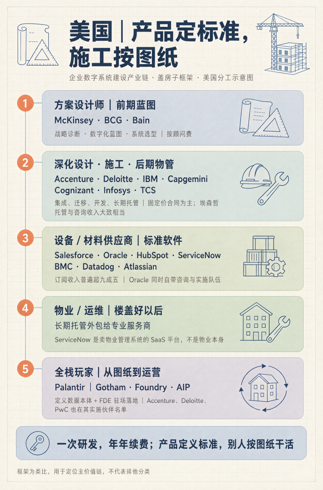
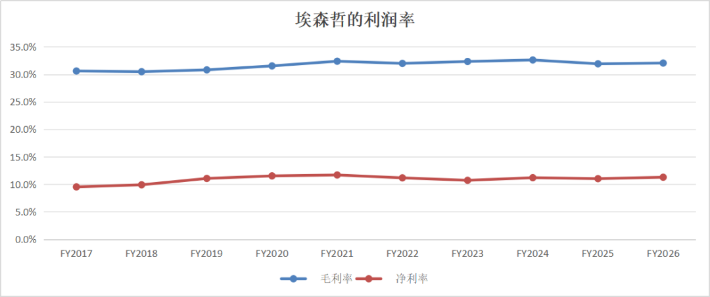
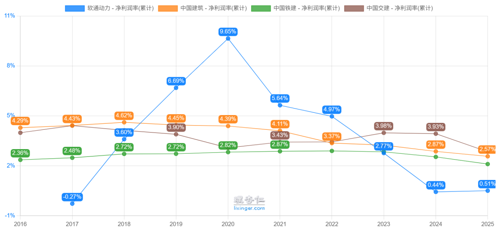
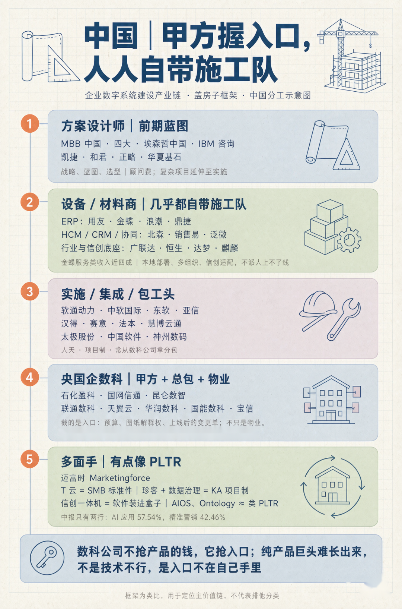
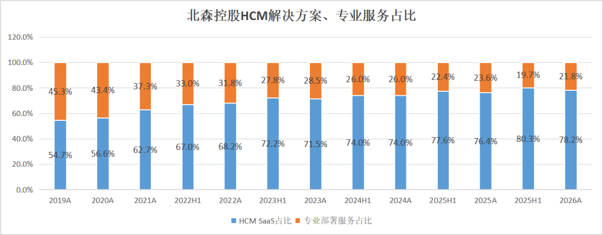
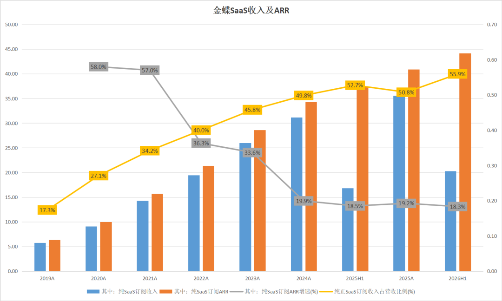
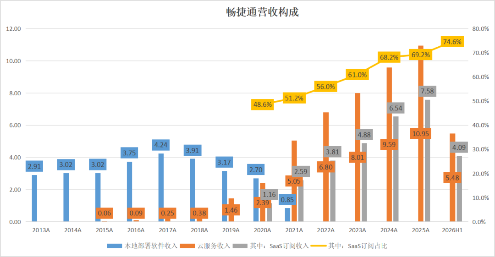

# 企业数字系统建设就像盖房子，但中美工地不一样（公众号文章）

> 来源：微信公众号「庶人投资笔记」，原创\
> 原文链接：https://mp.weixin.qq.com/s/Xi5njgxmLSebhhW6D2nJLw\
> 作者：庶人哑士\
> 发布时间：2026-11-07 07:30（四川）\
> 关联篇目：作者后续篇《中国企业软件：一次非对称的投资机会》（2026-11-15，本库已入库）明确标注「上一篇 企业数字系统建设就像盖房子，但中美工地不一样」；本篇亦为 11-15 篇「过去三四个月研究成果」的前置框架文\
> 作者提示：个人观点，仅供参考\
> 入库时间：2026-11-16

---

## 摘要（3 分钟速读）

> 核心话题：中美企业数字系统产业链分工差异 · 中国软件公司毛利率为何低 30 个点 · Palantir 纵向打穿 · 中国式「多条腿走路」 · ERP/HCM 细分领域能否长出中国 SAP/Workday

**一句话核心**：用"盖房子"比喻企业数字系统建设——**美国是方案设计（MBB）／总包实施（埃森哲）／材料设备（Salesforce 等标准软件）／物业运维各赚各的钱，Palantir 则用统一 Ontology 底座把咨询、工程、产品压进同一交付单元纵向打穿；中国从一开始就没形成分层：央国企数科公司吃掉设计与物业入口，产品商被迫自带施工队，实施商在数科分包与生态夹缝中求生**——作者直指"**国内 356 家软件上市公司 2024 年前三季度净利润合计仅 68.96 亿；定制化项目毛利率 30%–60%、项目制 28%–35%、SaaS 毛利率不到 40%，美国同行 70%——差的这 30 个点不是技术差距，是分工结构差距**"。但结论并非全无希望：**AI 让开发成本大幅下降、在位者客户数据与分发渠道变成更稀缺的护城河，中国工地上暂时长不出 Palantir，但可能在 ERP、HCM 等细分领域长出中国的 SAP、Workday**。

**关键数据**（每条注明出处：正文 / 图号）

- **埃森哲**：FY2026 咨询收入 **368.8 亿美元**、托管服务 **373 亿美元**，几乎对半开；前 200 大商业客户 **85% 合作超过 20 年**。总包毛利率常年 **30%–35%**、净利率 **10%–12%**（正文 §一，图 B）
- **Salesforce** 约 **七成**实施由咨询伙伴主导；**SAP** 全球生态 **两万多家**合作伙伴公司、**上百万**顾问（正文 §一）
- **Palantir** 毛利率 **84%**，"卖的是结果，不是人天"；驻场工程师同时干咨询、工程、产品三件事，定制代码抽象成平台能力回流总部（正文 §一）
- **埃森哲 2026-10 被曝请摩根大通评估出售大中华区业务，估值上限 15 亿美元**；同期与 Anthropic 合作培训约 **3 万名**专业人员、与 Google Cloud 合作培训最多 **1 千名**前置部署工程师（正文 §一）
- **软通动力** 2025 营收 **350.9 亿**（硬件 158 亿占 **45%**、软件与数字技术服务 189.6 亿增速仅 **4.64%**）；华为相关收入占比接近 **30%**；归母净利 **2.06 亿**、扣非仅 **0.42 亿**、净利率 **0.5%**（正文 §二）；图 D 显示其净利率从 2020 年 **9.65%** 跌至 2025 年 **0.51%**
- **北森** 云端 HCM 毛利率 **82.7%**、专业服务毛利率仅 **12.9%**——"交付本身几乎不赚钱，但不能不养这支队伍"（正文 §二）
- **中国 356 家软件上市公司** 2024 年前三季度净利润合计 **68.96 亿**；定制化项目毛利率 **30%–60%**、项目制 **28%–35%**、SaaS 毛利率**不到 40%**，美国同行 **70%**（正文 §三）
- **迈富时**中报收入结构：**AI 应用 57.54%、精准营销 42.46%**（图 C）；作者评其"原本约等于【0.3×HubSpot＋0.6×ACN＋0.1×PLTR】的无限弱化版"

**核心矛盾**

1. **分工结构差距 ≠ 技术差距**：美国每层都有足够厚土壤（"只卖电梯也可以，只画图纸也可以，只当物业也可以"），中国"只卖电梯的公司会被问能不能顺便把安装也做了，只画图纸的公司发现甲方自己就有设计院，只当物业的公司会被数科截胡"
2. **Palantir 纵向打穿 vs 中国多条腿走路**：Palantir 靠**统一 Ontology 底座在底下压缩成本**，咨询/实施/产品在同一套本体论上；迈富时、滴普、迅策、范式、深演智能的 SaaS、项目制、一体机、数据治理"更像是并行的收入曲线，而不是同一个能力在不同场景下的展开"
3. **数科闭环是行政性的，产品商施工是被迫的，实施商分包是成本驱动的**——中国工地目前"长不出这个形态的土壤"
4. **迈富时的战略张力**：作者承认它在同业中"时最有希望朝着美国同行靠近"，但批评老板"沉迷于和各地政府的资源勾兑，放着好端端的轻资产软件生意不做，非得要做 Neocloud 这种高 CAPEX、高杠杆、高风险刀口舔血的生意"，结尾"实在是可惜"
5. **"中国没有纯 SaaS 土壤"是伪命题**：金蝶、北森、畅捷通的财报已证伪；但也承认中国产品商无法像 Salesforce 那样把实施完全甩出去

**跟踪要点**

1. **ERP、HCM 细分领域是否长出中国的 SAP、Workday**——作者点名的候选是金蝶、北森、畅捷通（"SaaS 已经跑通"），用友被迫壮士断腕转云
2. **AI 是否在位的客户数据/分发渠道上形成更稀缺护城河**——这是作者对"未来变化"的核心假设，未给量化判据
3. **总包商学 Palantir 的姿势**：埃森哲一边被曝评估出售大中华区业务，一边与 Anthropic / Google Cloud 培训前置部署工程师——传统分工"因时而异"
4. **迈富时是否继续做 Neocloud**：作者把高 CAPEX／高杠杆视为对轻资产软件生意的背离，列为负面观察
5. **交付端能否甩出去**：金蝶与毕马威、软通动力、中软国际合作建交付体系（海信二期交 KPMG、浙江交投二期交 PWC），是否降低实施占比、抬升毛利率

**局限提示（阅读时注意）**

- 全篇为**个人观点与框架性判断**，"盖房子"为作者自述比喻（"可能不够严谨，但对于我来说，很熟悉，用起来顺手"），文中公司归类（如"迈富时约等于 0.3×HubSpot＋0.6×ACN＋0.1×PLTR"）为作者主观映射，**非公司官方口径、非可计算估值**
- 图 A / 图 C 示意图底部自注"**框架为类比，用于定位主价值链，不代表排他分类**"，引用时勿当作行业权威分类
- 图 B 为**无数值标签折线图**，本表数值为按轴目测，**非原始数据点**；正文只给区间（毛利率 30%–35%、净利率 10%–12%），未给逐点值
- 图 D 水印 `理杏仁 lixinger.com`，为第三方数据图，非公司财报原文；部分年份标签缺失或重叠，已标"待核"
- 作者明示"个人观点，仅供参考"；本文**无目标价、无仓位建议**

---

## 正文（完整原文）

**盖房子这个比喻可能不够严谨，但对于我来说，很熟悉，用起来顺手。麦肯锡画图纸，埃森哲当总包和物业，Salesforce卖电梯，Palantir从设计到物业全包。但把中美两边真实的财报和交付现场放一起看，中国这一个工地现场的现实很扎心，但却并不是全无希望。**

**下面先把美国那边工地的情况拆开来看一看，再看中国实际怎么运转。**

### 一、美国：设计、总包、材料、物业，各赚各的钱

麦肯锡、BCG、贝恩（MBB）在企业数字化里干的是方案设计。企业要上什么系统、流程怎么改、组织怎么调，他们出报告。报告交付完，事情基本结束，后面施工不归他们管。这块按项目收费，纯知识型，一个项目几百万到上千万美元。

埃森哲、德勤拿过方案做深化设计和实施。深化设计就是把"要建一个智能供应链"翻译成"SAP哪个模块配哪个接口、数据从哪来到哪去、上线分几个阶段"。然后派人驻场，写配置、做集成、迁数据、培训用户。上线之后还有托管服务，帮客户运维、升级、优化。

这条产业链上的大致分工如下图：

> 原图：https://mmbiz.qpic.cn/sz_mmbiz_png/zgZ4D9nwqgEoBwLkooXRowJZVeD8Fia1oJsnq9tNghVE0xtTVXv5wZdnnNNwslQunftRfgekbiaXgpibE2ChCSu3BPL6FmgjPDlFbHxTzCfrrg/640?wx_fmt=png&from=appmsg

埃森哲2026财年咨询收入368.8亿美元，托管服务373亿，几乎对半开；前200大商业客户里85%合作超过20年。它赚的是长期关系的钱，不是一锤子买卖。咨询收入是一锤子买卖，项目完工就结束了；但托管服务像物业一样，每年都能收钱。总包单位虽然苦，但也常年能够拿到30%~35%的毛利率、10%~12%的净利率。

> 原图：https://mmbiz.qpic.cn/mmbiz_png/zgZ4D9nwqgFX8HR8lwfsRQRW0LkYunliaqXpR1j1JaY1ciazYub8dHugAQVKQq5UaibJZJ9iauQJkUaRp9rBKDZReZJ9ibRrvFt0OLpHD95OxJnk/640?wx_fmt=png&from=appmsg

Salesforce、Oracle、SAP、HubSpot这些是设备材料商，产品标准化，按订阅或license收钱，实施交给咨询伙伴。直接可以对标迅达电梯、大金空调、海螺水泥。

Salesforce大约七成实施由咨询伙伴主导，SAP全球生态里有两万多家合作伙伴公司、上百万顾问。产品商不碰工地，咨询商不造产品，分得干干净净。这套分工成立的前提是：全球一套标准能反复卖，离岸交付压人力成本，本地团队负责落地和客户关系。核心是知识变成产品，能复用，同一套方法论在德国做完，改改拿到中国再卖一遍，边际成本很低。

Palantir在这套体系里是个异类。它不派初级顾问去现场写需求文档然后回总部排队等研发，而是把全栈工程师直接派到客户办公室，和行业专家配对。既负责搞清楚业务上到底要解决什么问题，又负责在客户那堆脏数据和旧系统上直接搭本体、写生产代码、上线跑通。

关键不在驻场，外包公司也驻场；关键在于驻场的人同时在干咨询、工程和产品三件事。每个客户现场跑出来的定制代码，会被抽象成平台能力回流总部，下一个客户再进来时标准件比例更高，部署工时往下掉。Palantir卖的是结果，不是人天，毛利率能到84%。

这一套打出来，埃森哲最先感到压力，它与PLTR既是竞争，也有合作。2026年10月它被曝出请摩根大通评估出售大中华区业务，估值上限15亿美元。同时它在和Anthropic合作培训约三万名专业人员，和Google Cloud合作培训最多一千名前置部署工程师。

全球最大的总包商在学Palantir的姿势，这事说明传统分工也不是一成不变的，会因时而异。

### 二、中国：没有独立设计师，数科公司是总包兼物业，产品商自己下工地搬砖

把同一套角色往中国套，就有点水土不服了。独立只卖方案不碰实施的战略咨询，在中国企业软件采购的预算表里是边缘科目。坐在设计师位子上的，往往是央国企自己的数科公司，或者华为、阿里云这类既卖云又做顶层设计的平台方。

数科公司是中国工地上最具特色的一环。联通数科、中电信数智、中移数智，名义上是数字科技子公司，实际干的是一条龙：整合系统集成、数字化咨询、大数据和云服务，面向政府和央国企交整体方案，交付完了运维也攥在自己手里。

联通数科拿下的华电云平台、沈阳政务运维，都是进去就长期绑定的项目。它先当甲方，再当总包，最后当物业，闭环锁死。外部实施商从数科手里拿分包，利润空间就被压得很薄。

软通动力是这条分包链上的真实样本。2025年营收350.9亿，硬件158亿，占45%；软件与数字技术服务189.6亿，增速只有4.64%。华为相关收入占比接近30%，昇腾、鲲鹏、鸿蒙全栈绑定。但归母净利润2.06亿，扣非只有0.42亿，净利率0.5%。

这这个利润水平，大概就是和中建、中交、中铁在一桌吃饭的水平：

> 原图：https://mmbiz.qpic.cn/mmbiz_png/zgZ4D9nwqgGKxY9ibH3pQbVHmDoygarX2ky2Y9SLerribMicdFec46JicUhF8oJicMHttJycCSACia8RiaxtsmKjN2N5GK8vFO9hBd08M6hN7BkAu4/640?wx_fmt=png&from=appmsg

软通既是包工头，又是软硬件代理商：它确实在出人力、拿分包，但它同时还在卖服务器、卖一体机、卖算力硬件。纯人力的毛利撑不起一家九万人的上市公司，中国的包工头必须兼着卖建材，哪怕硬件毛利率薄得可怜。

金蝶、用友、北森、广联达、畅捷通的生态位好很多。其中又以SaaS已经跑通的金蝶、北森、畅捷通为最佳。

> 原图：https://mmbiz.qpic.cn/mmbiz_png/zgZ4D9nwqgE6UqsagJMyT8QdiceoU0VpSfnMqR3uFfjFvWHlHApW9tficteVPoAjiakkQpDOATWry628IIV7DqHNtXvw0mhDLRGOwM7hHH5JbM/640?wx_fmt=png&from=appmsg

金蝶产品分层做得清楚，苍穹做PaaS底座，星瀚打大型企业，星空打中型，星辰打小微。但到了交付端，它没法像Salesforce那样把实施完全甩出去。它的做法是一边自己下场，一边养生态：和毕马威、软通动力、中软国际合作建交付体系，海信二期交给KPMG，浙江交投二期交给PWC。

北森云端HCM毛利率82.7%，专业服务毛利率只有12.9%，交付本身几乎不赚钱，但不能不养这支队伍。因为工地上的总包和物业不接标准化产品的活，你不自己搬砖，砖就永远砌不上墙。

> 原图：https://mmbiz.qpic.cn/mmbiz_png/zgZ4D9nwqgG9VvwJ2TrqiclsOPJGIpfD89HcxUosjEKibLgmdvyHR9CxyGvaugVOHdmCEdXIzh8VAo6OsZq6DhtezKN9dDCxoeFMt9Y6WYVlE/640?wx_fmt=png&from=appmsg

但金蝶、北森、畅捷通的财报显示：中国的产品型公司长不出纯SaaS产品形态是个伪命题。

> 原图：https://mmbiz.qpic.cn/mmbiz_png/zgZ4D9nwqgGu9hMbcsd5QA3UZpDmmSeY2eyztknNOLXgPK361nMtfB5TeWkV6RFlLibc5BM8bkLEgG8vAj7ovdjlhgbd7IsTMmUyqMh65Ddw/640?wx_fmt=png&from=appmsg

### 三、中国没有Palantir，但有多条腿走路的现实样本

很多港股上市公司都喜欢对标Palantir，自称中国版Palantir。比如迈富时，SMB端有T云对标HubSpot，KA端做AI应用和Agent解决方案，卖信创一体机，搞数据治理的项目制交付，自建算力中心。哪样赚钱搞哪样，几条腿走路，每条腿的毛利和交付逻辑都不一样。

但说它像Palantir，纯属往自己脸上贴金。Palantir的纵向打穿靠的是一个统一的Ontology平台在底下压缩成本，咨询、实施、产品在同一套本体论上，驻场写代码和卖软件不矛盾，定制工作被持续抽象成平台能力。

不管迈富时也好，滴普、迅策、范式、深演智能也罢，目前看不到这种统一的技术底座在起压缩作用。SaaS、项目制、一体机、数据治理、更像是并行的收入曲线，而不是同一个能力在不同场景下的展开。它不是纵向打穿之后形成了平台垄断力，而是横向铺开之后还在找哪条腿能站稳。

这是中国软件公司最现实的生存策略：哪条路能赚到钱，就长出一条腿。

美国那条产业链分层清晰，各吃一段，但被Palantir纵向一体化打通。中国这条链上从一开始就没有形成分层：数科把设计和物业一起吃掉了，产品商被迫自带施工，实施商在华为、阿里生态和数科分包之间的夹缝中求生，迈富时、滴普、迅策、范式、深演智能这样的公司，被迫把多副面孔当成过冬的棉袄。

在美国，分工是贯穿始终的主题。你可以只卖电梯，也可以只画图纸，还可以只当物业，每一种角色都有足够厚的土壤。在中国，只卖电梯的公司会被问"你能不能顺便把安装也做了"，只画图纸的公司会发现甲方自己就有设计院，只当物业的公司会被数科截胡。

国内356家软件上市公司，2024年前三季度净利润合计只有68.96亿；定制化项目毛利率30%到60%，项目制28%到35%，SaaS毛利率不到40%，而美国同行是70%。差的这30个点不是技术差距，是分工结构差距。

### 四、未来已经有了变化

Palantir被我反复拿出来说，不是因为它什么都做，而是因为它证明了一件事：当咨询、产品、工程、物业被压缩进同一个交付单元，底下有一个平台兜住定制化的成本，纵向打穿是可以长出垄断力的。

中国工地上目前还没有长出这个形态的土壤，数科的闭环是行政性的，产品商的施工是被迫的，实施商的分包是成本驱动的。

但AI正在改变一些东西：传统本都部署软件已经显得越来越落伍，北森、金蝶、畅捷通的示范效应，让用友也不得不壮士断腕向云端转型；AI让软件企业的开发成本大幅下降，在位者的客户数据和分发渠道变成了更稀缺的护城河。

当下的中国数字化工地上，还长不出真正的Palantir，但可能在ERP、HCM等细分领域，长出我们的SAP、Workday。

至于迈富时，它原本约等于【0.3\*HubSpot+0.6\*ACN+0.1\*PLTR】的无限弱化版，在和滴普、迅策、范式、深演智能这一众公司的竞争中，时最有希望朝着美国同行靠近的。

但无奈它老板太沉迷于和各地政府的资源勾兑，放着好端端的轻资产软件生意不做，非得要做Neocloud这种高CAPEX、高杠杆、高风险刀口舔血的生意。看着它的那一长串的座上贵宾名单、各地研发总部和数据中心的项目清单，不由让我想起当年意气风发的王健林、孙宏斌。

实在是可惜。

> 原图：https://mmbiz.qpic.cn/sz_mmbiz_png/zgZ4D9nwqgGw3LNfR9cr6fmVick9q8via8pxwwIZniaGUKe1xibYnqYkd82UOEoGtcxDRHX7Zoc3eTWa1iaDKOOicdxrlaRMW3kE1fuO4tBgdgcxU/640?wx_fmt=png&from=appmsg

---

---
