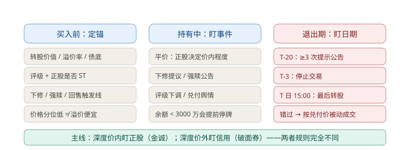

# 可转债 · 规则地图

> **一句话定位**：可转债的规则不是散点，按「买入前定锚 → 持有中盯事件 → 退出期盯日期」三阶段归类；核心主线是**深度价内盯正股、深度价外盯信用**——两类券用的是完全不同的规则集，混用必错。

**配图**：（同一内容的可视化版本）

## 一、三阶段规则地图

| 阶段 | 盯什么 | 具体条目 |
|---|---|---|
| **买入前：定锚** | 算清这张券是股性还是债性 | 转股价值 / 溢价率 / 债底；评级 + 正股是否 ST；下修 / 强赎 / 回售触发线；价格分位低 ≠ 溢价便宜 |
| **持有中：盯事件** | 盯定价锚的变化 | 平价：正股决定价内程度；下修提议 / 强赎公告；评级下调 / 兑付舆情；余额 < 3000 万会提前停牌 |
| **退出期：盯日期** | 盯不可逆的时间窗 | T-20：≥3 次提示公告；T-3：停止交易；T 日 15:00：最后转股；错过 → 按兑付价被动成交 |

## 二、两类券的规则分叉

| | 深度价内（例：金诚转债 113615） | 深度价外（例：破面券） |
|---|---|---|
| 定价锚 | 正股价格 × 每券可转股数（Delta≈1） | 纯债价值 / 到期兑付价 |
| 关键变量 | 正股涨跌、到期日 | 信用资质、现金流、评级变动 |
| 到期风险 | 市价远高于兑付价，**不转股即巨亏** | 市价接近或低于兑付价，赌兑付确定性 |
| 到期动作 | 卖出或转股，二选一，错过不可逆 | 持有到期拿本息，或提前止损 |
| 例子 | 11-26 收 407.58 元 / 转股价值 409.08 元 / 兑付价 112 元，不转股亏 72.5% | 宏图 CC、三房 A-、美锦 A、闻泰 BBB-、芳源 BBB、百畅 BBB+ |

## 三、退出期时间规则（上交所）

依据《上交所上市公司自律监管指引第 12 号》第二十条、第三十五条：

| 时点 | 规则 | 后果 |
|---|---|---|
| T-20 交易日 | 至少发布 3 次提示性公告 | 提醒投资者转股期结束前 3 个交易日停止交易 |
| T-3 交易日 | 停止交易（转股仍可继续） | 不能再二级市场卖出 |
| T 日（到期日）15:00 | 最后转股时点 | 错过后无补救通道 |
| T+1 | 摘牌、兑付资金发放 | 未转股部分按兑付价被动成交 |

**例外**：流通面值低于 3000 万元，公告 3 个交易日后可提前停止交易，不必等到 T-3。制度设计初衷（上交所 2022 发布会）：在停止交易后留 3 个交易日供投资者继续转股，减少不必要损失。

## 四、容易踩的口径陷阱

- **价格分位低 ≠ 溢价便宜**：2026-11-26 价格中位数 119 元为近一年最低，但百元平价溢价率仍在 90% 分位——价格低是因为平价（73.5 元，5% 分位）崩了，不是溢价被杀。
- **发行时评级 ≠ 当前评级**：筛"AA 以上"必须用最新债项评级。闻泰发行 AA+ → 现 BBB-、三房 AA → A-，按发行评级筛会多出假候选。
- **转股期 ≠ 交易期**：金诚转债最后交易日 12-17、最后转股日 12-22，中间 3 个交易日只能转股不能卖；两个日期不是一回事。
- **转股价修正 ≠ 转股**：下修是调整转股价（需董事会提案+股东会 2/3 通过+持债股东回避），转股是持有人主动申请，二者独立。

## 参见

- [[articles/concepts/期权Wheel策略-卖期权收保费]] — 期权卖方收保费，与可转债"债底+看涨期权"结构互补阅读
