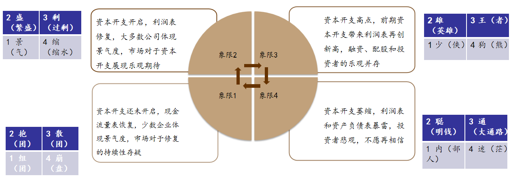
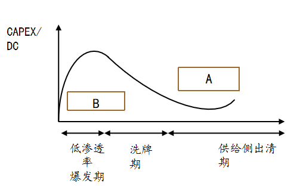

# 2026-11-02 投资感悟 · 读王文、丘栋荣、戴斌三篇访谈

> 性质：本人原创感悟（非外部资料摘要），按口述原话记录整理，仅作排版分节，未增删观点。\
> 记录日期：2026-11-02\
> 触发：连续读完三篇基金经理／投资人访谈后有感\
> 关联：[[感悟/投资感悟索引]] · [[感悟/2026-10-29-投资感悟-ST人福困境反转的遗憾与可识别性]] · [[感悟/2026-10-23-投资感悟-2444实施路径与泡泡玛特深研]] · [[疯狂的里海/里海-2444投资体系]]

## 一、所读三篇（素材）

| 人物 | 一手资料 | 一句话核心（原文摘要口径，非本人观点） |
|------|----------|--------------------------------------|
| **王文**（日斗投资创始人、董事长） | [[../../raw/research/投资/基金经理/2026-10-28-管清友对话王文-周期仓位与杠杆的底层思考]] | 散户亏损的根源是**位置摆错**（把自己当强者，实为链条末端）；四条铁律**低估值 · 高现金流 · 高分红 · 可持续**，加一条时机纪律**不买下行周期，等有人退出（出清）再进场** |
| **丘栋荣**（前中庚，现 TriValue） | [[../../raw/research/投资/基金经理/2026-10-13-丘栋荣TriValue路演-低估值方法论与美元定价中国资产]] | **低估值通常是「雷」**，机会来自**基于不确定性定价**——研究未来回报的概率分布，只在风险补偿足够大时主动承担风险；资本投入决定回报 |
| **戴斌**（六禾致谦基金经理） | [[../../raw/research/投资/基金经理/2025-09-11-聪明投资者访谈戴斌-资本周期的四象限与老登小登]] | 分析起点**不在需求预测，而在供给侧**——用「估值 / 资本开支 / 机构行为 / 上市公司对股票的行为」四维定位**资本周期四象限**，在资本流出端买入，「出首富 + 机构配满 + 暂停回购改配股」处离场 |

> 三篇原文均为**访谈口述整理**，数字多为受访者自述口径，未附原始计算；读取时以各自 raw 页头的「局限提示」为准。

## 二、我的感悟 · 丘栋荣（体系框架读后感）

> 依据：`raw/research/投资/基金经理/2026-10-13-丘栋荣TriValue路演-低估值方法论与美元定价中国资产.md`（内部录音整理稿，十章 · 十三节，管理人口径，无量化阈值）

### 第一部分 · 投资体系（1–5 与工具层）

#### 1. 第一性原理：钱从哪来（第四、七章）

- **第一性原理**：「首先，结果是低估值——我们只接受低估值的东西。这意味着一期回报一定来自资产本身的盈利和现金流：我不是指望股票涨……这是我的第一性原理」。只接受低估值 ⇒ 买入价隐含回报率必须够高 ⇒ 回报只能由资产自身现金流兑现，不依赖别人用更高价接手；低估值不是买入理由，是这套判断做完之后浮出来的价格。
- **落到动作**：只问两件事——① 资产能不能不断创造现金流、赚的钱越来越多；② 买入价格隐含回报率够不够高。
- **不预测**：不预测市场／股价／业绩；煤炭股 3 倍 PE、20% 分红时「我希望它永远不要涨」，不涨才能分红再投资，「三年后你就等于零成本」。
- **边界**：不预测业绩 ≠ 不看成长。补记里说「我们另外最好的东西，它们都是成长股」「买股票最终不都是看成长吗」，且「不要用某种风格来框定我们」；「价值」「很逆向」「中小盘」等标签他都否认。

#### 2. 未来不可知 → 正确地承担风险（第四＋八章）

- **不确定性是前提**：「未来这家公司会怎么样、会怎么赚钱，在我们看来是完全不确定的」；宏观／尾部问题一律「我不知道」。既不能把风险算准，也躲不掉：「哪怕是在最低点，也没有任何一个点位是『确定』的」；归零概率约 **0.5%/年**（200 个独立市场 ≈ 200 年一遇），「我们的目标不是追求绝对安全」。
- **定价与承担（同一件事的两面）**：把未来摊成一整片可能结果，「研究它未来回报的概率分布——什么情况下会这样、什么情况下会那样」，只算可能性大小与回报补偿——「一方面计算风险的可能性大小，另一方面衡量它能带来多少回报」「这种风险补偿是足够的」——再决定承担哪一份。「基于不确定性定价」是算法，「正确地承担风险」是动作；这一段自己的收尾就是「本质上，它是一个风险定价的问题，低估值只是最终的表现」。做小盘时要求同事「先忘掉估值，然后去演算『什么最可能』」。
- **三条决裂与买入双前提**：「低估值通常是『雷』」「不是均值回归」「不是周期投资……绝大部分公司宿命是归零」，故更愿意做空低估值；低估值先验是风险信号而非安全垫，买入须过「你的风险研究必须是可靠的……我们买的低估值，其实是希望它同时是低风险的、是努力的公司」。
- **分布方向与表达**：「确定性是向上的，你愿意给它 15 倍、20 倍……确定性是向下的，那就另当别论」——万科 10 倍 PE 判泡沫、20 倍小盘反而便宜；表达分三档「不买／不看好／做空」，尾部用 PUTs 约 **2%** 成本对冲 **100%** 头寸，具体刻度并入 §5。

#### 3. 超额从哪来：三重价值（第七、十章，全篇收尾点题）

- **优势**：约 **60 分**，靠更深调研、更广视野，投入资源和时间最多，却「是最不重要的」，只决定及格与否。
- **创造性**：60→90 的差异来源，发现「市场（甚至我们自己）没有经历过的、完全不同的全新机会」，「跟努力关系不大，不可强求」。
- **风险**：「比创造性更重要的一层，也是回报的最大来源……而我们愿意去产生这种风险」。三者按重要性递增，不并列；全篇收尾点题，TriValue 就是「竞争优势、创造性和风险」。
- **边界**：「真正好的机会，一定是之前没有出现过的」、「Alpha 就像蘑菇一样，一见光就死了」，且他怀疑「能力可以稳定跨越周期」；但创造性依赖 20 人团队、4,000 家找 100 家、一季度看 37 家苏州公司，「在商业模式上是不成立的」，不可复制、不可强求——此处已接第二部分。

#### 4. 外层：内核不变、形态一直换（第一、二章）

- **内核不变**：「我们的思路在过去十几年是一贯的……正因底层是一样的，它表现出来的形式和样子才会很不一样」。
- **形态一直换**：低估值大盘蓝筹（2013–2017，组合 PE 4 倍）→ 中庚小盘（中证 1000，三高）→ 多空（2021）→ 港股通（2022 年底）→ 美元定价的中国资产；每次只由「当时什么又好又便宜」决定，「跟我们 2014 年买格力、2019–2020 年买小盘，逻辑一模一样」。
- **边界**：所有风格标签他都否认；「内核不变」≠「能力可跨周期」，形态主动换正因旧能力不保证下个时代仍有效。学他学的是这条链，不是某类产品；周期位置、利率、容量只改落点，统一归 §5。

#### 5. 贯穿的输入与约束（不参与骨架分层）

- **周期位置**：只作风险识别输入。地产周期高位使万科当期盈利不可持续、产业生命周期后段使价值股被新技术摧毁、2021 年起的收缩使供给不足——不是收益来源，他明确否认「周期投资」。
- **资本投入／供给**：「决定超额资本回报的最核心原因，并不是需求、不是景气，而是资本投入——大约 **80%** 的权重来自你往里面花了多少钱」；连续四年收缩（周期下行／企业主观行为／广义监管三因）→ 竞争缓和 → ROIC 上升，房地产新项目与当年煤炭同理。这是 2026 才进入核心的判断。
- **利率与资金环境**：「中国利率非常低、钱太多」→ A 股跌了也不便宜；「美元利率很高……钱在那边不断流出」＋非港股通南下资金进不去 → 才有「美元定价的中国资产」这个洼地，两个条件须同时满足。
- **风险参数与表达**：分布方向决定可接受估值；归零概率约 **0.5%/年**、「时间越短，你的风险越小；时间越长，不确定性反而越高」，决定回报的只有定价位置与真实 α；表达三档「不买／不看好／做空」、「『不看好』和『做空』之间是有很大距离的」，PUTs 约 **2%** 对冲 **100%** 头寸。执行 §2 时的刻度，不另成一层。
- **容量与交易流动性**：「容量是市场给的，不是能力给的」；2014 年最没经验反能管 1,000 亿，现在能买 200 只但「有的股票买 500 万都很费劲」。约束，不参与定价。
- **不设行业边界**：全市场公司级扫描（4,000 家找 100 家、20 人研究员团队、一个季度看 37 家苏州公司）。属覆盖面，不是定价。

#### 工具层 · PB-ROE（不遗漏，但须标证据边界）

- **定位**：估值／筛选工具，不进骨架。「不是所有的数据、所有的 PE 都可以拿来估值」「PE 是相对的，因为它可能跟你的成长是有关系的」「估值本身反映的其实是这样一个概率分布」——PB-ROE 处理的是 PB 与 ROE 的静态匹配，相当于给某一个可能结果定价，而内核要求先把未来摊成概率分布。此定位为我的理解，非原文表述。
- **出处（库内三处，均无正文）**：链接索引 `2026-11-04-聪明投资者-丘栋荣戴斌王文-公开发声链接索引.md` 收 2020-02-21 深访全文《深访业内领先的 PB-ROE 模型践行者…》（`cmtzz.cn/article/31690`，正文未入库）；戴斌访谈 Q13 自述「2021 年我只关注商业模式，不注重 PB-ROE 性价比」，属他人提及；本份原文 **PB-ROE 零命中**，唯一 ROE 出现在谈美股科技「从 ROE 上看，一定是不行的」，另有 ROIC 用于供给收缩判断，「风险管理」「资产配置」「无风险利率」同样零命中。
- **待补**：其构造、阈值、样本及与「基于不确定性定价」的衔接，库内无一手正文，需先把 2020-02-21 深访（及索引 §二 33 场全文）入库后再写；在此之前不填具体规则，也不以三大模块为主轴。

### 第二部分 · 基金公司治理（6）

#### 6. 基金公司治理（组织层，非投资方法）

- **定位**：基金公司需要处理的事，解决「方法能否被执行」，不解决「买什么」，故单列为第二部分。
- **金字塔五层**：投研/产品 ＜ 销售系统 ＜ 品牌 ＜ HR 系统 ＜ 顶层治理与文化；「投研是最不重要的」，只是必要项。
- **三难**：自己的人性／客户的人性／老板（权力）的人性，最难是决定何时发产品、何时要钱；十年期内部回报约 **23%** 出头而投资者只拿到约 **12%**，故「永远只在低点的时候发产品、永远在高点的时候封闭」，并反对三年／五年期封闭产品。
- **规模是负债**：「100 亿的规模，本质上就是 100 亿的负债」「最好的规模是零」；从「一流资产管理公司」三维退到「一流的投资回报」一维，「三个 80 分，不如一个 100 分」。
- **组织配置**：团队 5+5、在编约 15 人、不支持任何人做全市场投资、香港 4／9 号牌与开曼架构。

### 附：口径提醒

- **数字口径**：全部业绩、概率、权重、容量数字均为管理人口径、未经第三方核验，原文多处自标。
- **文本完整性**：封面标称约 3.9 万字而实得 **22,519 字符**，存在删节；待核 4 项——新能源占比「25%」原文自标待核、「万科与格力定价之争」时点附注 PDF 中未见、「详见问答部分」／「详见第十章附文说明」无对应章节。
- **可迁移边界**：原文没有 PB 阈值、概率赋值或仓位公式；能迁移的是决策顺序与证伪纪律，不是可运行的参数。

## 三、我的感悟 · 王文

> 依据：`raw/research/投资/基金经理/2026-10-28-管清友对话王文-周期仓位与杠杆的底层思考.md`
>
> 「认知／修行」二分出自原文 Q21「总结：认知第一，修行第二」：「投资其实分为两个部分：第一部分就是认知，第二部分是修行」；「认知决定成败」「你越接近于真相，越接近于成功」，修行是「第二个层次」，要「一辈子要像个小学生」。

**主轴**：先认清自己是弱者（认知），再管住自己别乱动（修行）。

### 认知

1. **位置**（Q1、Q9）：多重博弈（国家／地方政府／大股东／管理层／社保／公募／庄家，最后才轮到散户）＋波动率「数倍于」美股 → 「所有的失败，都是你是个弱者、你以为你是个强者造成的」「位置首先要摆正」；市场同时提供投资、投机、赌博，「投资只占最小的部分，连 5% 都没有」。
2. **真钱与假钱**（Q2、Q16）：伊泰 B「0.7 美元买入、每年分红 0.8 美元」，张双旺「其实投资就是分红」↔ 靠垫资挣假钱的房地产产业链、「GDP 公司」「对国家好，对地方政府好，对投资者不好」；「有现金流就是馅饼，没现金流就是陷阱」。解药是四条铁律——低估值、高现金流、高分红、可持续，「四条全齐了就不会爆雷」，且「分红不造假」是反造假校验。
3. **资本周期与出清**（Q3、Q4）：回避下行周期，判据是「看有没有人退出，看有没有人破产」，没看到就「顶多买个哨兵，绝不会下注」；「只要退出很难的，就很难反转」。「一定要买那些它好到溢出来了，好到可以分钱给你了」——债务不彻底出清，外部股东拿不到钱；地产若见底「不用买房地产股票，应该买银行股」。**同戴斌的资本周期，但王文只用一个退出信号，不做四维象限定位**。
4. **定价环境**（Q10、Q11）：「房地产给全社会提供了一个虚假的无风险收益率」，破灭后金融新周期成本端全面下移；「**偏见造成的低估才值得参与**」「偏见一定会消失」，当下偏见就是「很卷」；「第一个 50% 可能拿三年，涨了 50% 以后，下一个 50% 三个月就完成了」——跟偏见做斗争，对人性的要求很多。

### 修行

1. **随喜功德**（Q12、Q13）：「不嫉妒别人的成功」「你成功，恭喜你」「一定要摆正自己的位置」；回扣认知 1 的弱者位置。
2. **因果与耐心**（Q11 末、Q21）：「在因上要执着…听缘的风声…果上随缘」「执着于因，听缘的风声」，缘来了才加仓；认知上「永远保持谦虚、专注、努力」「如何清零、重返到一个原点」，「这是绝大多数人做不到的，因为它跟人性是相悖的」。
3. **大跌与诚实**（Q17）：「大跌了怎么办？没钱就睡觉，有钱就加仓」「大概率不要看你的账户就行了」；「错了要承认，要极致的诚实」「不能你当鸵鸟是没用的」。

### 约束层（不进骨架）

组合（个股 ≤25%、行业最重 40%、前十占 80%）、不要孤注一掷（Q15）；「加杠杆属于博士后课程」（Q18）；「投机必须善始善终」，最忌「投机被套后改口叫价值投资」（Q19）。

## 四、我的感悟 · 戴斌

> 依据：`raw/research/投资/基金经理/2025-09-11-聪明投资者访谈戴斌-资本周期的四象限与老登小登.md`（配图逐格转写见该文文末「配图转写」）

### 我的理解

**1. 戴斌的体系是以资本周期为体系，最终还是自下而上落到具体企业上面**

- 定义（Q3）：「高回报吸引资本和竞争，低回报资本退出，由此产生的资本流入、流出的规律就是资本周期」；分析起点「不是对最终需求的预测，而是从供给侧开始」（Q4）。
- 落到企业的两条投资哲学（Q3）：「第一，投资在高壁垒企业以及资本流出的行业」「第二，管理层长期布局资本的能力很重要，要重点关注企业新的资本开支、并购和处置、增发和回购」。
- 目标（Q5）：「在资本周期开始好转时在萧条的行业中找到投资机会，以及在那些具有较好和稳定的供给侧基本面的行业中找到投资机会」；「该少买的少买，该多买的多买，到了特定阶段就慢慢减持」。
- 原典（图①，马拉松资本《资本回报》）：四阶段循环「高回报吸引资本投入和竞争，并带来低回报」，ROI 曲线结论「低回报退出并带来均值回归」；戴斌把它中国化成四维定性判断。

**2. 通过资本周期结合 4 个维度：上市公司对股票的行为、资本开支、机构行为、估值，对资本周期进行行业 4 象限的定位**

- 四维原文（Q3）：「我用数学中的象限来简单标注，其中有四个重点参考维度，即上市公司对股票的行为、资本开支、机构行为以及估值」。
- 循环 4→1→2→3→4（图②圆盘，逆时针）：**象限4** 估值十年底部、资本开支下降、利润表与资产负债表暴雷、机构减持完毕、企业回购增持、媒体风评差 → **象限1** 资本开支未开启、现金流量表恢复、少数企业景气、少数机构组团买入 → **象限2** 资本开支开启、利润表大范围修复、多数机构抱团、少数配股减持 → **象限3** 资本开支高点、利润创新高、融资配股与乐观并存、出现「首富现象」、现金流开始出问题。
- 离场信号（Q4）：「中国某行业出首富是最强烈的资本信号」「机构配到 20% 多时行业就结束了」；另有配股、大股东减持、资本开支大增、媒体争议。
- 量化尝试（图③）：以渗透率为横轴、CAPEX/DC（资本开支/折旧）为纵轴。新能源车 2018–19 渗透率个位数 → 电池成本降至单车 5 万元、补贴后接近内燃机 → 渗透率暴增 → 「股价往往在渗透率达到 20%–30% 时就已经演绎结束」；这类公司算资本利得用「峰值利润 × 一定估值」。

**3. 通过债性、自由现金流、利润表、SOTP 和目标市值法，对 A 股的自由现金流和非自由现金流进行分层估值**

- 两类公司（Q5）：A 股约 80% 公司没有自由现金流。有 FCF 者（石油石化、煤炭、食品饮料、交通运输、家电、通信运营商、某些医药、有色金属、公共事业、互联网）在资本开支下降时把现金流返还投资者；无充裕 FCF 者（基础化工、电力设备、电子、建筑装饰、农林牧渔、国防、新能源、光伏）利润表增长来自阶段性供需不平衡。
- 资本利得来源不同：「前者更看重债性和债性变化的资本利得，后者更看重市值扩张的资本利得」，不能用同一把尺子估值。
- 估值钟摆四层（Q6，自下而上）：① 债性（银行、公共事业、能源；最低为格雷厄姆清算式）② 自由现金流（白电、中药、消费兼具债性与 FCF）③ 利润表盈利（化工、电子、医药等中游，需大额资本开支）④ SOTP／目标市值法（创新类，只在熊转牛时被采用）。「越往下估值安全性越高，也更偏绝对回报；反之越往上推，估值越危险」。
- 跨层错位＝机会：「2022 年互联网巨头利润表的估值就跌落到偏债性的估值体系；2024 年的一些创新企业也从 SOTP 法估值跌落到格雷厄姆的清算估值体系」。

**4. 最终是通过阳和阴面进行仓位配置**

- 阳面（Q11）：「AI 确实是景气度和共识都高的领域，与内需无关」；但「这种供应不足，可能在 2–3 年就在工业进步和资本涌入下供过于求」，中国企业在 AI 产业链「更多是乙方的角色，承接美国的资本开支和制造外包」。
- 阴面（Q11）：「当下景气度和共识都差的顺周期板块，以及上一轮繁荣但未来尚不确定『反内卷』政策是否有效的消费链条和『碳中和』链条」。
- 另一组坐标·反内卷 A/B 面（Q10）：A 面＝2022–23 年已发生产能过剩、股价下跌、无人持有的白酒／碳中和制造业；B 面＝当时资本开支低、避开过剩风险的运营商／能源（现能源已开始增加资本开支、运营商性价比下降）。
- 不是二选一（Q13）：「我会努力在『阳面』中寻找估值还能理解的低估值公司，在『阴面』中寻找产业格局可能有利于尽早进入复苏的公司」；「对于『阴面』的适当触角，会使得投资组合的波动下降」。操作上「慢慢减仓高景气、高共识板块，在低景气、低共识板块中找结构机会」；组合目标是回撤的深度与时间「少一点、短一点」，而非收益最大化。

### 骨架图

**图② 资本周期「四象限」模型**（图源：六禾致谦）

> 左上象限2／右上象限3／左下象限1／右下象限4，中心箭头为 4→1→2→3→4 逆时针；左右四组绰号属配图文字、正文未出现。

**图③ 新能源车渗透率 × CAPEX/DC 图谱**（图源：六禾致谦）

> 纵轴 CAPEX/DC；曲线在爆发期达峰、洗牌期末触底、末段回升。A、B 两框原图只有字母、无文字，原文亦未解释；两轴均无刻度。正文数字注脚（不在图上）：2018–19 渗透率个位数 → 电池成本降至单车 5 万元 → 股价常在渗透率 20%–30% 时已演绎结束。

## 附：待答问题

1. 三人的共同前提是**从供给/资本进出出发**，而不是从需求景气出发——这套视角能否直接接上 2444 的「变化论」与「周期介入」？
2. 同为「便宜」，王文说**有现金流就是馅饼**，丘栋荣说**低估值通常是雷**——分歧在风险定价，还是在对「下行周期」的不同读法？
3. 三人都给了**可验证的离场/入场信号**（出清＝有人退出；机构配到 20% 多；出首富；暂停回购改配股）——哪些能落成本人可跟踪的清单，与《周期介入》§六 的「风险下限清单」合并？
4. 三篇都在讲**位置**（弱者在哪一层、风险补偿够不够、行业在哪个象限）——与 ST 人福那篇「有变化、被发现、没介入」的遗憾，是同一个问题吗？
